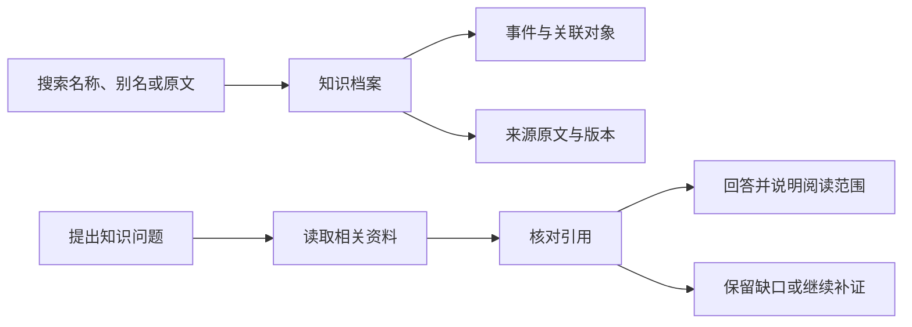
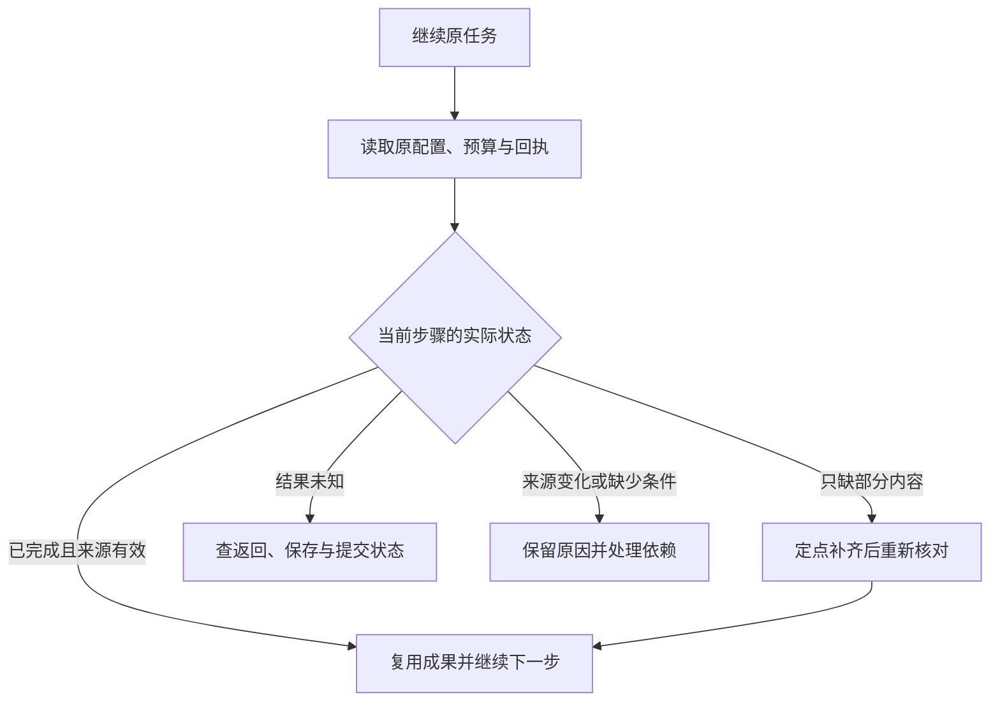
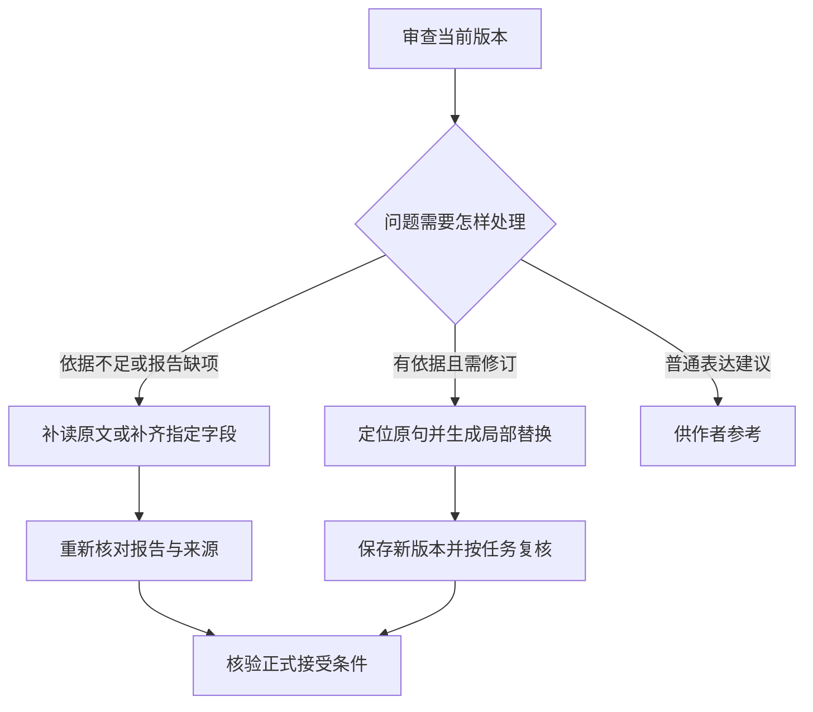

# 墨流 0.8.0 版本更新

0.8.0 围绕知识检索、技能调用、长任务恢复和桌面体验展开。本页汇总相对上一正式版的产品变化，以当前源码为依据。

Windows 安装包、VS Code 扩展包及校验信息见对应的 [GitHub 版本发布记录](https://github.com/littlewinter320/inkflow/releases)。部分最新界面交互仍待原生验收。

## 大更新

### 1. 全书知识库与原文问答

资料积累以后，查找一个对象往往要在设定、事件、规划和正文之间来回切换。0.8.0增加独立的全书知识库，把这些已有资料组织到统一入口。作者可以按名称、别名或原文内容搜索，从结果打开完整档案，再沿关系查找相关对象。档案保留来源和版本，便于看清一条记录来自哪份资料，以及它描述的是已经发生的事、未来安排，还是某个人物的认识。

进入知识目录后，可以先按类型筛选，再选择对象阅读经历与关联资料。需要进一步查证时，可以在对话中提出知识问题，由系统寻找相关原文、核对引用并汇总回答。回答会交代实际阅读范围；如果只读到了部分材料，覆盖范围会随结果保留。个别引文无法匹配时，已有合格部分可以保存，未通过的部分继续定点补证。

知识整理支持后台分段处理。每段完成后保存进展，发生中断时可从已有断点继续；正式资料更新后，也可以安排增量维护。作者能够给知识条目补充说明，将尚无定论的内容保留为设想或待核线索，暂时搁置后再恢复处理。这样既能积累查证结果，也能看到仍然存在的资料缺口。

日常使用时，可以先搜索定位，再打开原文确认，最后决定是否需要继续询问。浏览已有目录使用本地记录，模型问答和后台整理则按任务配置与预算执行。知识中心已经有部分原生使用观察，具体问题的回答质量仍取决于实际阅读覆盖和来源是否充分。

下图展示知识查询的处理关系，属于功能示意。

### 2. 三维知识关系图

界面截图展示392个对象的关系分布。选中对象位于视图中央，右侧可查看关联记录、原文入口和完整档案。

当资料中的对象越来越多，列表适合查找具体条目，关系图则便于观察它们如何联系。0.8.0在知识中心加入三维关系图，依据实际连边组织空间群组。关系较密集的对象位于中央，相关对象沿邻近轨道分布，不同类型使用不同颜色。节点大小参考有效内容与去重引文，可以帮助作者在整体画面里找到资料较丰富的对象。

浏览关系图时，可以先旋转、平移和缩放观察群组，再点击感兴趣的节点。选中后，视角移向该对象，检查栏同步显示档案摘要、关联对象和原文入口。点击「查看完整档案」可回到同一页的目录阅读区。孤立对象也保留展示位置，已有关系能够回到档案中核对。

知识目录、事件与时间、全书关系图改为同一页纵向排列。关系图工具栏可直接指定节点数量或勾选「不限数量」，默认显示50个对象。这个选择控制当前画面的投影数量，完整知识目录与检索范围独立保存；画面同时显示已展示数量和总量，便于判断当前看到的是多大范围。节点大小体现资料权重，人物或事件的重要程度仍需结合内容判断。

这项功能适合梳理对象联系、寻找可继续阅读的资料，以及检查某个对象是否缺少相关记录。当前已有原生点选、视角居中和显示数量的观察依据，物理触控板操作仍待验证。对象及连线增多后，实际流畅程度还与设备性能有关，更新说明暂不承诺统一的帧率或容量表现。

### 3. 技能与提示词管理

0.8.0把可复用的工作方法放进技能管理入口。作者可以搜索技能名称，查看用途、适用角色、提示词和完整流程，再调整启用状态及触发条件。需要明确使用某种方法时，在聊天输入“@”选择技能；技能有必填参数时，界面会提供对应表单。这样一次任务采用了什么方法，有了可以查看和指定的位置。

技能分为内置、个人和本书三个范围。同名技能优先选择本书版本，其次是个人和内置版本，也支持带范围的明确指定。方法类技能可以组合，流程类技能按当前任务选择一条。被动触发还要满足启用状态、角色和步骤条件，作者可以设置关键词及排除条件，减少无关方法进入当前工作。

管理页面支持新建简单模板，以及导入单个技能文件、目录或单技能压缩包。导入后先查看内容，保存为待启用候选，再决定采用。技能涉及的自动工具执行受墨流已登记能力约束。正在进行和恢复中的任务使用已经固定的技能版本，更新方法后，新任务按新的选择执行，便于追查不同结果各自依据了什么。

真实任务会记录技能使用情况和对应回执，作者可以查看学习记录与改进建议。改进保留原包、版本和来源，形成候选供后续采用。执行完成、失败和结果未定分别留下记录，实际效果仍要看任务产物。完整流程可以在设置里阅读，模型执行时按角色和步骤装入有关部分，避免每次都重复传入整份说明。

下图展示导入技能到任务使用的主要步骤，属于功能示意。

### 4. 长任务恢复与完成结果复用

长任务可能已经完成生成，却停在审核、保存或附属资料整理。0.8.0细化了这些阶段的恢复处理。继续执行时，系统先找回原任务的配置、版本、累计次数和已有回执，再判断哪些成果仍可使用。已经完整保存、来源有效的结果可以接着处理，只缺少局部字段时，也可以把补救范围缩小到对应位置。

作者可以用普通中文继续原任务，系统沿原目标安排剩余步骤。恢复过程中会检查当前资料是否仍与原输入相符，以及正式提交是否已经完成。发生版本变化时，需要核对受影响部分；结果未知时，先查已有返回和保存状态。此前实际发生的模型请求和用量继续累计，恢复后的界面也能显示当前停点与剩余范围。

本次修复了一类容易造成重复工作的情况：执行器虽然跳过了已完成步骤，但后续判断没有拿到对应成果。现在有效完成回执会重新进入结果判断，帮助协调角色接着安排下一步。批量处理待办时，每完成一项都会刷新依赖，继续处理新解锁的事项；独立缺项保留断点，其他具备条件的工作可以推进。

对作者而言，恢复时应能看到工作已经到哪一步、目前缺什么，以及接下来将处理哪里。生成保存、审核通过、正式提交和附属整理各有状态，部分完成可以准确呈现。已有部分真实恢复观察支持这些变化；涉及旧版本兼容、来源失效或明确取消的任务，仍要按具体回执判断可继续的范围。

下图展示恢复判断的主要分支，属于功能示意。

### 5. 有依据的审查与局部修订

审查意见需要对应当前原文和有效资料，作者才能判断该改什么。0.8.0细化了证据补核、报告修复和局部修改的处理方式。报告只有少量引文、来源关系或必需字段缺失时，可以交给原责任角色读取对应资料后补齐；合并后继续核对结构、原文和版本，已有有效判断保留在同一条处理记录中。

当问题已经有足够依据，修订优先定位当前版本中的连续原句，再生成局部替换。替换位置、原文匹配和修改范围都要经过检查，保存后形成新版本，并按任务要求继续核对。作者可以知道本轮实际派了哪些修改，哪些意见仅供参考；未选中的建议有独立状态，避免被混入本轮修复结果。

正文收录关注正史连续性、关键因果和当前硬要求。已证实的严重矛盾需要修复，必要资料不足则需要补读或补证。普通表达建议与质量观察提供给作者作判断，正式接受仍检查版本、记忆交接和授权。这样一份报告中的不同问题可以获得对应处理，作者也能追查结论所依据的原句。

界面反馈进一步区分修改已保存、当前版本待核对和审核通过。局部替换成功后，旧版本与原报告仍可供对照，新版继续走自己的审查流程。遇到只要求查看意见的任务，操作范围遵循当次委托。这项更新已有局部修订和定点补证的运行依据，文学表达是否符合作者偏好，仍需要结合具体结果判断。

下图展示审查发现问题后的处理方式，属于功能示意。

### 6. 按角色配置模型思考与上下文

不同角色处理的工作不同，需要的资料量和思考策略也有差别。0.8.0为节省、平衡、高质量三档分别配置五个角色的常用取材量、最大容量和思考策略，自定义档支持手调。常用取材量影响日常准备多少资料，最大容量约束可扩展空间，实际输入还会受到模型窗口、输出预留和必要来源的限制。

聊天选档和设置页面使用同一份预设。同一次委托包含不同任务段时，可以分别指定档位，每段在开始时保存自己的设置。正在执行或恢复的任务按原配置快照继续，作者之后调整默认值时，可以明确区分哪些新任务会采用变化。逐角色设置也保留实际模型能力的约束，参数是否发送由对应适配处理。

模型接收过程增加了更清楚的状态。MiMo区分连接保活、思考、正文与收尾，连续没有新数据时按请求进展判断恢复方式。已经收到的内容、完整结果和实际尝试次数都会保留，未知用量单独记录。作者观察进度时，可以知道连接是否仍有传输，以及是否已经开始返回模型内容。

官方OpenAI请求将稳定资料和规则前置，变动内容后置，便于复用相同输入前缀。缓存页面按供应商实报计算，同时显示统计范围和缺报情况。配置的目的在于让资源安排可控、过程可查；具体速度、命中率及合格产物成本，需要结合实际模型和任务比较。此版本继续保留这些效果的真实观察边界。

### 7. 桌面布局与视觉美化

桌面的这一轮调整集中在阅读顺序、间距和信息层次。顶栏按用途整理常用操作，统一按钮高度、图标尺寸、边框和组内间距。标题、状态与工具按钮各自留出空间，长标题可以缩略，较窄窗口通过滚动容纳工具。工作台入口采用适度强调，其余常用按钮保持简洁，便于作者打开页面后找到需要的操作。

聊天区延续纵向阅读方式，输入框随换行适度增高，达到上限后在框内滚动。当前公开动作与用时入口保持紧凑，详细过程按需展开。历史消息较多时先加载近期内容，计时与文字分别刷新。欢迎区、任务概要和输入位置经过整理，让作者查看进度、阅读回复和继续输入时有清楚的视觉顺序。

设定与技能页面采用可搜索列表和详情区域。目录承担定位，详情承载长内容，模块配置及诊断记录按需展开。常用开关移到容易找到的位置，重复信息收起，状态原因和可执行操作保留在对应区域。「语音、审查与维护」按语音、审查和高级设置纵向排列。工作台布局提供左右分栏、上下分栏和同区叠放三种预设，面板仍可手动拖放、拆出窗口和调整比例。

主题、配色、显示密度、节点上限、预填续写、智能提示词和快捷键统一保存到桌面本机目录。旧记录补足缺失字段，已保存的偏好在退出或更换开发地址后优先恢复。此次修改通过桌面界面和 Electron 主进程的 TypeScript 检查，退出重开、新布局和窄窗口显示仍待原生验收。

## 其他更新

### 8. 需求追问支持分轮回答

遇到影响结果的重要取舍，协调角色会先查现有资料，再提出需要作者决定的问题。适中档每轮询问一项，多问档可同时提出独立选择，选项说明后果和推荐理由。回答与原题、任务和配置绑定，条件明确后继续剩余步骤，作者可以逐步确定需要落实的方向。

### 9. 待答支持自由填写

待答选择增加自由输入，作者可以写出预设选项之外的决定，也可以稍后回答或拒绝。提交时保留实际填写的文字，输入草稿按问题身份保存，切换问题后读取对应记录。原题与来源发生变化时重新核对，避免把旧问题的答案错误用于新的选择。

### 10. 续写可以使用临时章目标

超出近期规划范围时，写作流程可以结合有效前文、作者要求及已有规划，准备当前章节的临时目标。场景与因果由写作角色随任务完成，连续任务仍以原终点为准。作者明确要求先调整规划时，执行对应的规划流程，临时目标与正式生效规划保留各自身份。

### 11. 规划修订缩小到受影响范围

规划修改会核对当前层级及其依赖，复用仍有效的上层内容，对发生变化的部分进行定向修订。跨层引用的伏笔定义和当前窗口的推进安排分别检查，发布前核对一致性。作者能够保留已经确认的规划，并查看候选改变了哪些内容以及需要继续处理的依赖。

### 12. 章节与伏笔集中浏览

草稿箱和正史书架按篇章分组，支持搜索章号和标题。伏笔与钩子页面展示规划中的安排、已经发生但未结束的线索以及来源待核记录，可按类型、跨度和进度筛选。展开后可以查看原因、条件、预计区间和核验依据，浏览与筛选使用本地已有资料。

### 13. 设定目录支持搜索与分栏阅读

本书设定采用目录与内容分栏，作者可以先搜索条目，再阅读完整记录。模块配置按需展开，待处理差异保留编辑和决定入口，源设定可以跳转到原编辑位置。相关事实与事件也有浏览入口，页面显示已具备的内容和覆盖缺口，便于判断还需要补充哪些资料。

### 14. 旧检索资料按版本退出使用

检索增加对来源版本和有效区间的核对。正文修订后，旧摘要会退出当前候选，查询回到对应版本原文；内容完全相同的重复来源合并展示并保留别名。含义不同的记录继续保留对照，历史事实也可按章节时点查询，减少旧资料参与当前判断的机会。

### 15. 知识整理可收起到后台

知识窗口提供收起到后台的操作，整理进度仍可从后台任务入口查看。正式资料提交后可以安排增量维护，事件更新进度和异常提示，主对话仍能接收其他独立请求。停止、失败与恢复沿用各自任务记录，重新打开窗口时可以查看已保存的进展和具体原因。

### 16. 附属整理有独立完成状态

正文接受后，相关索引和设定交接分别记录处理状态，后台可在原任务预算内继续补齐。目录和待办核销会检查当前版本、来源及实际回执，完成的旧交接进入历史。作者能够看清哪些主体工作已经结束、哪些附属资料仍需处理，并从对应入口继续。

### 17. 长聊天按需加载

长会话默认挂载最近40条消息，较早内容按需查看，折叠的过程详情在展开时渲染。流式进度合并刷新，候选和事件缓冲控制数量，历史文字复用已有转换结果。已有原生显示观察支持这些调整，持续长时间运行的耗时与内存收益仍需同口径对照观察。

### 18. 连续任务进度更贴近实际阶段

连续任务会显示当前章节正在写作、审查或收录，并保留已经接受的数量。最新收稿回执在长过程滚动中继续保留，恢复诊断使用实际停止位置。暂停后可查看仍待继续的批次，作者因此能区分本轮停点、已完成部分和后续范围，详细依据可以按需展开。

### 19. 模型配置保存与连接检查分开显示

模型设置使用文本框填写默认及角色型号，保存时检查必要字段。界面分别提示已保存、缺密钥和生成检查结果，显式连接检查会发送一次短请求，并核对完整返回、型号及结果格式。检查可能产生费用，实际结果以当前保存的服务地址、型号和密钥为依据。

### 20. 用量与缓存统计说明范围

用量页面将累计请求和Token放在前面，角色卡片显示近期请求的加权缓存比例、已报告未命中量及统计时间。无调用、未报告与明确零命中分别呈现，详细记录按需展开。作者查看某个百分比时能够知道统计窗口和缺报情况，并结合任务结果判断实际消耗。

### 21. 桌面朗读统一使用微软在线语音

桌面朗读入口统一到微软在线语音，声音按可用目录选择，设置集中展示连接、版本、朗读范围和设备。原本使用MOSS的用途需要重新选择启用方式，历史本地音频可继续播放。本地普通话听写仍按需配置，在线朗读会把实际需要朗读的文字发送给语音服务。

### 22. 音频与录音记录更容易管理

听读中心可以查看转换结果、暂停或继续任务，并管理停止后的音频副本。同名任务按创建时间区分，删除记录保留原段数和时间，便于识别。麦克风录音与转写支持搜索、播放及查看文件；保存路径无法安全确认时会显示原因，由作者先核对位置。

### 23. 最近打开记录保存到桌面本机目录

成功打开项目后，首页保存标题、路径和打开时间，下次可以直接点选。开发服务端口改变时，最近记录仍从固定桌面数据目录读取。移除快捷记录与删除项目文件有独立操作，文件删除使用系统回收站并要求确认，作者可以明确自己正在整理哪一类内容。

### 24. 退出后找回工作位置

退出前保存当前项目、面板布局、编辑位置、未发送输入和未保存候选。重新打开时先读取本机记录，若文件已经发生变化，候选会先供对比。工作中的退出保留可核对的中断状态，明确停止有单独标记，等待中的消息也保留暂停状态，方便从实际进度接着处理。

### 25. 停止按钮对应当前运行

聊天栏的停止操作直接发送当前运行的取消请求，已经进入保存阶段时显示实际状态。重复停止按同一次任务处理，避免影响保存收尾。活动任务计数也排除了部分被动读取，空闲退出更符合真实状态；作者可以据界面反馈判断请求是否仍在执行或已经结束。

### 26. 技能经验关联真实结果

技能使用经验保留用户要求、实际工具顺序、版本来源与程序回执，后续任务可以参考相关的少量案例。完成、失败、等待和结果未知分别记录，作者评价也保留对应样本身份。技能改进据此生成建议，实际模型调用与费用仍进入原账本，经验效果需由后续结果观察。

### 27. Claude Code 与 MCP 共用引擎入口

Claude Code 启动适配与通用MCP入口整理到 integrations 目录，调用同一个共享引擎。启动脚本向Claude Code追加根项目规则，MCP配置指向对应服务。使用者需要自行完成宿主安装、配置与信任确认，各入口的任务权限、版本核对和提交条件由共享核心执行。根使用指南提供启动命令与相关源码位置。

### 28. 使用指南与扩展打包资源统一维护

根README扩展为36章完整指南，从安装、首次使用讲到独立技术原理，配套阅读路线、流程图、关系图截图、常见问题和术语解释。正文超过四万个汉字，已核对章节锚点、图片与本地源码链接；软件运行效果按各章节实际依据说明。VS Code五步引导使用随包文本，扩展说明从根README生成。桌面、扩展、引擎及启动器统一准备0.8.0版本配置，交付内容以实际发布回执为准。
