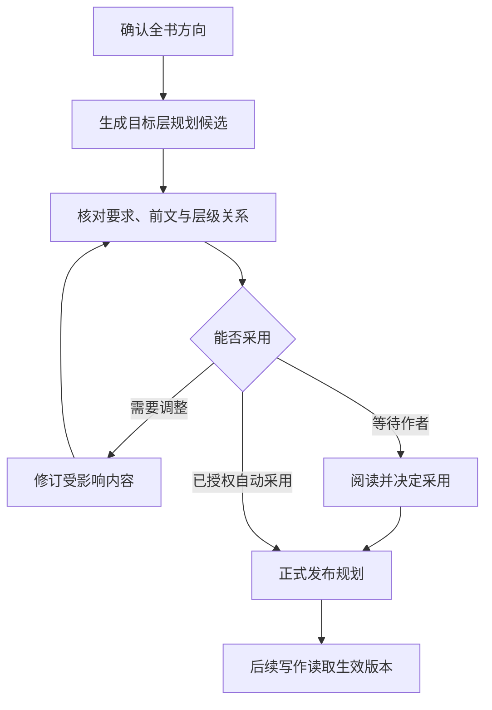
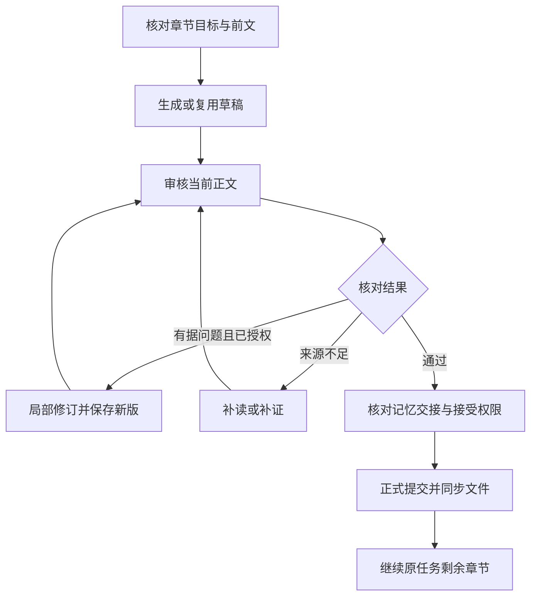
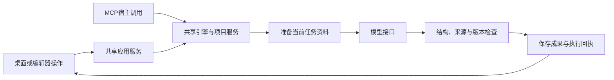
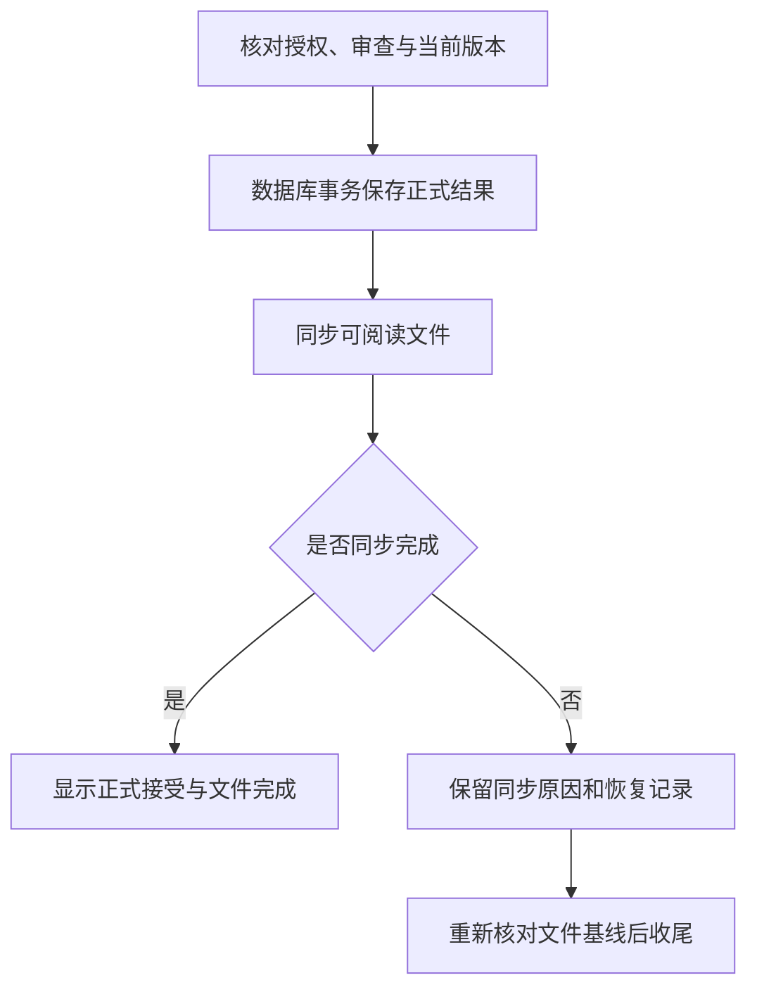

# 墨流 InkFlow

**面向中文长篇创作的 AI 协作工作台。**

墨流把讨论、规划、写作、审查、知识整理和版本恢复放在同一个项目里。作者用普通中文表达目标，协作角色按职责处理，软件核对来源、版本与授权，再保存可查看的结果。你可以从一个构思开始，也可以打开已有项目，查看资料后继续尚未完成的工作。

**当前源码版本为 0.8.0。** 安装文件以版本发布页实际提供的附件为准。本文解释当前源码的功能与使用方式，已安装版本的交付范围请结合对应发布说明阅读。

[版本发布页](https://github.com/littlewinter320/inkflow/releases) · [0.8.0 更新说明](CHANGELOG.md) · [问题反馈](https://github.com/littlewinter320/inkflow/issues) · [项目许可证](LICENSE)

桌面端面向 Windows，另有 VS Code 扩展、Claude Code/MCP 接入和命令行入口，复用同一个共享引擎。项目资料保存在本机；调用云端模型时，任务需要的资料会发送给所选服务商。使用在线朗读时，待朗读文字也会进入相应语音服务。服务账户、密钥、模型权限和费用由使用者按实际选择配置。

<a id="guide"></a>
## 怎样阅读这份指南

第一次使用可以先读第01至05章，了解项目、安装、连接和界面，再按第06至10章完成一次范围明确的任务。遇到具体问题时可直接跳到第31章，想理解术语则看第34章。技术原理集中在第21至30章，每项技术先解释作用，再沿实际模块说明输入、处理过程和结果。

文中的自然语言示例均为说明操作的假设场景。流程图是实现关系示意；知识关系图中的图片为作者提供的界面截图，图中数量反映截图时的状态。部分最新界面和边界行为仍需原生验收，相关章节保留具体适用条件。

| 阅读目的 | 推荐顺序 |
| --- | --- |
| 从零开始使用 | [认识墨流](#chapter-01) → [安装与版本](#chapter-02) → [首次连接](#chapter-03) → [项目管理](#chapter-04) → [界面操作](#chapter-05) |
| 开始规划和写作 | [表达任务](#chapter-06) → [角色协作](#chapter-07) → [质量档](#chapter-08) → [分层规划](#chapter-09) → [章节流程](#chapter-10) |
| 检查和整理已有内容 | [审查](#chapter-11) → [局部修订](#chapter-12) → [设定](#chapter-13) → [知识库](#chapter-14) → [记忆与伏笔](#chapter-15) |
| 使用技能和辅助功能 | [技能](#chapter-16) → [作者习惯](#chapter-17) → [后台与恢复](#chapter-18) → [语音](#chapter-19) → [隐私](#chapter-20) |
| 理解程序怎样工作 | 从[架构](#chapter-21)开始，按需求进入调度、模型、上下文、检索、缓存与数据章节 |
| 排查或反馈问题 | [常见问题](#chapter-31) → [检查点与恢复](#chapter-32) → [表达示例](#chapter-33) → [术语](#chapter-34) → [反馈](#chapter-35) |

## 完整目录

| 章节 | 内容 |
| --- | --- |
| 01 | [从零认识墨流](#chapter-01) |
| 02 | [选择安装方式并理解版本](#chapter-02) |
| 03 | [第一次启动与连接配置](#chapter-03) |
| 04 | [创建、打开与管理项目](#chapter-04) |
| 05 | [读懂桌面工作台](#chapter-05) |
| 06 | [用日常中文安排任务](#chapter-06) |
| 07 | [五个角色怎样分工](#chapter-07) |
| 08 | [质量档、思考与容量怎样选择](#chapter-08) |
| 09 | [从全书方向走到章节安排](#chapter-09) |
| 10 | [一章从草稿到正式接受](#chapter-10) |
| 11 | [阅读审查报告，理解依据与结论](#chapter-11) |
| 12 | [局部修订、版本保护与手动改稿](#chapter-12) |
| 13 | [建立并持续维护本书设定](#chapter-13) |
| 14 | [使用全书知识库与三维关系图](#chapter-14) |
| 15 | [理解事实、事件、摘要与伏笔记忆](#chapter-15) |
| 16 | [查看、调用和维护技能与提示词](#chapter-16) |
| 17 | [作者习惯、反馈学习与写作素材](#chapter-17) |
| 18 | [处理待办、后台任务与中断恢复](#chapter-18) |
| 19 | [语音输入、在线朗读与音频管理](#chapter-19) |
| 20 | [数据位置、隐私与日常安全操作](#chapter-20) |
| 21 | [软件架构怎样把一次要求变成可检查的结果](#chapter-21) |
| 22 | [Coordinator怎样安排工作，权限怎样落实](#chapter-22) |
| 23 | [配置快照、版本和哈希为什么一起保存](#chapter-23) |
| 24 | [模型接口、流式接收与中断处理](#chapter-24) |
| 25 | [上下文怎样选资料，容量怎样计算](#chapter-25) |
| 26 | [RAG检索、版本有效性与知识关系怎样配合](#chapter-26) |
| 27 | [缓存命中、Token与费用怎样读](#chapter-27) |
| 28 | [数据库、Markdown与正式提交怎样保持一致](#chapter-28) |
| 29 | [技能如何进入请求，经验怎样形成参考](#chapter-29) |
| 30 | [开发运行、宿主接入与安装包怎样准备](#chapter-30) |
| 31 | [遇到问题时怎样判断和继续](#chapter-31) |
| 32 | [检查点、备份与恢复前的判断](#chapter-32) |
| 33 | [如何提出清楚的要求并读懂回复](#chapter-33) |
| 34 | [常用术语逐项解释](#chapter-34) |
| 35 | [怎样提供有效反馈与参与维护](#chapter-35) |
| 36 | [源码与资料索引](#chapter-36) |

<a id="overview"></a>
<a id="chapter-01"></a>
## 01. 从零认识墨流

### 01.1 墨流围绕什么组织工作

墨流是一套面向中文长篇创作的工作台。一本书从想法走到完整正文，通常会经历讨论方向、整理设定、规划故事、写出草稿、检查问题和接着写下一章。墨流把这些工作放在同一个项目中，使各次生成能够找到本书已经确认的内容，也让作者有地方查看要求、结果和还没有处理完的事情。刚开始使用时，可以先理解“项目、任务、产物”这三个词，再认识界面的各个入口。

项目是一部作品及其资料所在的工作空间。任务是你这一次希望软件完成的事情，例如讨论两个开篇方向，或审查一份已有草稿。产物是任务留下的具体内容，可以是一份大纲、一版正文、一份审查报告，也可以是一条等待你回答的问题。任务结束以后，产物仍然属于项目，后续工作可以在满足来源和版本条件时继续使用它们。

在这个过程中，作者负责决定写什么、哪些结果符合自己的判断，以及哪些修改值得采用。软件负责把要求组织成步骤，交给相应角色处理，再检查结果能否进入下一阶段。你可以分阶段使用它，也可以明确委托一段连续工作。任务越长，越需要说明范围、终点和重要限制，方便软件辨认什么算完成，以及何时需要回到你这里作决定。

### 01.2 阅读时先认识几种内容状态

“草稿”是已经写出来、仍可修改的正文候选。“正史”是项目已经正式接受的正文及其相应事实，后续创作会把它作为已经发生的内容来使用。“规划”描述未来准备怎样写，允许随着作者的新决定调整。“参考”提供背景和方法，使用时需要结合本书当前情况。界面中的这些名称会影响后续处理，因此查看文字时也要看看它处于什么状态。

一个通用的虚构示例是，作者在讨论里提出“也许让主角在雨夜离开小镇”。此时它可以是一个备选方向。方向进入生效规划后，后续章节准备会参考这个安排。正文真正写出离开小镇，并经过相应检查和正式接受以后，相关事件才成为后续创作所依据的已发生事实。作者可以沿着这几个阶段观察同一想法如何逐步确定。

“来源”说明一条判断依据哪里。“版本”说明依据的是哪一次保存的内容。即使章节标题相同，两次修改后的原句也可能不同。审查一份旧稿得到的结论，需要核对是否仍适用于新稿。墨流保留这些关系，是为了让作者能够追查问题并继续工作。日常使用时先阅读中文状态和原因，遇到争议再展开详细依据即可。

### 01.3 一次工作通常怎样展开

你先用普通中文说明目标。Coordinator 会理解要求并安排已有流程，Writer 负责规划或写作，当前协作模式中的编辑及专项角色负责核对，Novel Engine 检查权限、来源、版本和提交条件。过程中可能出现补读资料、局部修订或等待作者选择。最终回复应交代实际完成的内容，并指向可查看的产物和剩余事项。


图中表示一般关系，具体任务会选取需要的步骤。单纯询问项目状态，可以读取已有记录后回复。只讨论构思时，结果可能是几个方向和它们的取舍。明确委托写章时，任务才会进入相应生产步骤。看进度时，把自己原先要求的目标与当前阶段放在一起理解，比只看一句“处理中”更容易判断是否正在做正确的事。

### 01.4 初学者可以怎样开始

第一次使用可以选一个范围清楚的任务，先熟悉从输入到查看结果的过程。通用示例是“先帮我比较两个开篇方向，各说清主要冲突和后续发展空间，等我选定再做大纲”。得到结果后，检查软件是否只讨论了你指定的方向，解释是否具体，下一步是否仍在你愿意推进的范围内。确定方向后，再明确要求形成规划或生成一章草稿。

已有作品的作者可以先打开对应项目，阅读当前规划、已接受章节和待办，再决定要续写、审查还是调整后续安排。当前项目内容越完整，越值得先核对软件实际读取的范围。某个回答能够引用几段原文，说明它使用了这些依据；全书覆盖需要查看实际阅读记录。不同范围的结果具有不同适用条件，作者可以据此决定是否补充资料。

墨流提供生成、组织与检查能力，文字是否符合作者的审美仍需要阅读判断。某一份报告通过，代表该版本满足了相应流程的检查条件。读者体验、风格偏好和创作方向可以继续讨论，并形成下一项明确任务。入门阶段熟悉一次小范围工作之后，再逐步增加章节数量和任务复杂度，便于看清每一步的结果。[角色合同](agent/src/inkflow/role_protocol.py) · [任务协调](agent/src/inkflow/coordinator.py) · [共享引擎](agent/src/inkflow/engine.py)

<a id="quickstart"></a>
<a id="chapter-02"></a>
## 02. 选择安装方式并理解版本

### 02.1 当前版本与可下载版本

当前源码版本为 0.8.0。README描述的部分能力已经写入本地源码，安装包是否包含这些能力，需要查看实际发布记录。软件界面、源代码和安装文件各有自己的版本身份。阅读一项新功能时，先确认自己正在运行哪一个入口和版本，才能判断页面是否应当出现相应按钮，或某项修复是否已经载入。

公开下载以GitHub版本发布页实际列出的附件为准。准备安装时，查看版本号、发布日期、更新说明和附件名称，选择适合自己的Windows安装包。0.8.0 的安装文件及校验信息见对应的版本发布记录。[版本发布页](https://github.com/littlewinter320/inkflow/releases)

### 02.2 安装版适合怎样使用

安装版把桌面界面与所需的共享引擎一起交付。使用者下载发布页上的Windows安装程序，运行安装向导，选择安装位置，完成后从桌面或开始菜单打开墨流。正式安装包的具体文件名以对应发布附件为准。这里描述操作路线，安装是否成功需要以安装程序的结果和实际启动窗口判断。

初学者可以先把软件安装位置与作品保存位置分开理解。前者放程序，后者放你创建的项目。项目目录需要是自己知道的位置，后续打开、复制备份或寻找正文时都要用到它。某个安装目录存在，不代表作品已经保存在里面；某个作品文件夹存在，也不代表软件已经识别它为有效项目。进入项目后可通过文件入口核对当前正在使用的目录。

安装完成还需要配置生成服务。墨流运行在本机，云端模型服务按请求处理相关文字，服务账户、密钥和可用额度由所选供应商管理。首次使用最好把这两步分开完成，先确认墨流能启动并显示首页，再进入模型设置填写连接信息。这样出现问题时，可以区分软件启动、服务连接和具体生成任务分别处于哪个阶段。

### 02.3 开发版与其他入口

开发版从源码和本机开发环境启动，适合维护项目或观察最新改动的人。它需要现成的运行环境、依赖和正确的启动脚本。当前源码中的开发入口与打包入口各有配置，因此开发窗口正常打开只能证明这个入口当时可以运行。安装版还涉及引擎打包、资源复制和分发路径，相关步骤在开发章节单独说明。

除桌面外，项目还提供VS Code扩展、命令行和MCP接入。它们使用共享核心，却有各自的界面、启动方式和宿主条件。普通作者可以先围绕桌面版学习完整流程。已经在编辑器中工作的使用者，可以根据后文接入章节配置扩展或MCP。一个入口中保存的模型设置或项目路径，应按实际配置机制核对，尤其要注意当前操作的是哪一个项目。

### 02.4 更新前后看什么

准备更新时，先保存正在编辑的内容，查看当前任务是否仍在运行，以及是否有待答或未完成提交。升级完成后，打开原项目并确认标题、章节目录和当前状态。若项目需要额外处理，按软件明确提示检查相应条件。任务恢复使用原配置与已有回执，新安装版本的默认值也有自己的适用范围，恢复时应以实际任务状态为准。

读更新说明时，可以重点看三类信息。第一类是新增入口，例如知识中心或技能管理。第二类是行为变化，例如恢复时如何复用结果。第三类是交付与验证范围，例如哪些界面已经观察、哪些安装行为仍待核对。它们影响的操作各不相同。遇到疑问时记录软件版本、具体入口和原始提示，更容易定位问题。

### 02.5 怎样辨认安装和启动阶段的问题

没有看到墨流窗口时，先核对自己启动的快捷方式和安装位置。如果出现一个空白Electron窗口，说明可能打开了运行时或不完整入口，需要核对启动目标。窗口已经显示但项目打不开时，查看项目文件夹是否仍在原位置。窗口与项目都正常、生成失败时，再进入模型连接和任务错误信息继续查找原因。

目前仓库的Windows打包配置在桌面包文件中，安装程序名称随项目版本生成，共享引擎从对应发布目录进入资源包。准备源码环境的人应阅读打包脚本中的实际依赖和路径，日常作者只需使用对应版本的正式附件。来源可定位到包配置与发布脚本，实际安装体验则需由对应安装包验证。[桌面打包配置](desktop/package.json) · [发布构建脚本](scripts/build-release.ps1) · [共享引擎包配置](agent/pyproject.toml)

<a id="first-story"></a>
<a id="chapter-03"></a>
## 03. 第一次启动与连接配置

### 03.1 先认识首页

正常启动会保留欢迎首页。首页提供创建、打开项目及设置等入口，“最近打开”帮助你回到本机使用过的项目。首次使用时列表可能为空，可以先配置模型，再创建一个项目。已经有项目的人可以选择包含项目标识的目录，打开后核对作品标题和资料目录。明确从外部指定项目打开的情况，会按对应入口定位项目。

首页记录保存在这台电脑上。最近项目条目保存标题、路径和打开时间，作品正文仍位于原项目目录。若文件夹被移动或磁盘暂时不可用，最近条目仍可能存在，但打开时需要重新定位。作者看到一个快捷条目时，可以把它理解为通往项目的入口，并通过实际打开结果确认目录是否有效。

### 03.2 填写模型连接信息

进入“设置 → 创作与模型”，展开“服务连接”。首先选择服务商，再填写接口地址和模型名称，最后配置该服务商的API密钥。模型名称使用平台提供的实际模型ID。名称中某个字符、版本后缀或大小写是否有要求，要以所用平台的说明和实际返回为准。界面中的文本框允许手动填写，保存前应检查是否有空格或复制时带入了额外文字。

接口地址决定请求发送到哪一项服务。它通常是供应商提供的API入口，和用户浏览账号控制台的网址承担不同用途。使用兼容服务时，接口格式可能相似，账户权限和模型名称仍由具体服务决定。将服务商、地址、模型和密钥作为一组核对，可以减少在多个平台之间切换后把信息混在一起的情况。

密钥输入框使用密码式显示。已经为当前服务商保存过密钥时，更换密钥栏留空会沿用已存值。复制错误信息给他人排查时，可以提供错误类型、模型名称和请求阶段，密钥原文应留在配置位置。若服务商返回鉴权或余额相关错误，需要按该账户的实际状态处理，反复更换章节要求通常无法解决连接层的问题。

### 03.3 保存成功以后怎样检查

界面会区分配置已保存、密钥缺失和生成检查结果。“保存并检查生成连接”会发送一次短请求，可能产生费用。检查会核对已保存设置，要求完整返回并检查结果格式，部分官方接口还会核对返回的型号身份。使用者可以据此判断这一组配置是否完成了一次实际请求，再决定是否启动自己的任务。

一次短检查成功，证明的是当时这项短请求能够完成。较长任务还会涉及更大的输入、输出、持续连接和业务结构要求，因此后续仍应查看实际运行结果。检查失败时，先读取界面给出的原因，确认保存状态与当前填写内容是否一致。草稿中的修改还未保存时，已运行任务可能继续使用原配置，界面会显示相应区别。

### 03.4 先采用容易理解的配置

完成连接后，再选择协作方式与质量档。日常协作、按需加强和全面协作决定哪些职责参与工作，节省、平衡和高质量决定准备资料与核对的投入方式。两组选项各有作用，初学者可以先使用一组明确配置，完成一次范围较小的工作，再根据实际结果调整。某次输出不合意时，先判断是方向理解、资料缺失、表达偏好还是模型连接问题。

角色模型留空时继承当前默认模型。需要为某个角色使用其他型号时，可以展开角色设置填写模型ID，它仍使用当前服务商的接口和密钥。填写了一个专项角色的模型，也要由协作模式或当前任务决定是否调用该角色。使用前检查界面显示的“当前协作”和“已保存模型”，有助于确认设置之间的实际关系。

### 03.5 完成第一次小范围工作

通用虚构示例是创建项目以后说“先帮我整理一个双线叙事的故事方向，列出两条线各自的冲突和汇合条件，等我选择后再继续”。发送以后，观察当前动作，等待实际结果，再打开相关产物。你可以检查回复是否回应了指定目标、是否提出了需要你决定的问题，以及下一步的范围是否清楚。

如果你只想试写一章，也可以明确说明章号、必要要求和接受方式。第一次先把“发出请求、看到进度、查看结果、判断状态”这一轮走完整，会比同时修改大量高级参数更容易理解软件。遇到失败保留原话和错误提示，再按实际停点处理。配置、任务与产物分别核对之后，下一次使用就能够从已确认的位置继续。[设置界面](desktop/src/App.tsx) · [配置服务](agent/src/inkflow/config.py) · [后台通信入口](agent/src/inkflow/app_server.py)

<a id="chapter-04"></a>
## 04. 创建、打开与管理项目

### 04.1 创建窗口的三个阶段

新建项目按“选择保存位置、确定故事方向、确认创建”展开。第一步选择一个清楚、容易找到的目录。第二步整理书名、方向和必要信息，可以自行填写，也可以使用已有的AI构思入口。第三步回看将要保存的信息，确认后再创建项目。窗口会分别显示构思、创建和打开的状态，方便辨认当前正在处理哪一步。

选择目录后进入下一步，并不意味着项目已经生成。构思返回一个方案后，也可以继续编辑其中的内容。最终确认创建会通过共享建项服务保存项目。创建成功后再打开对应项目，就可以看到目录和后续操作入口。这个顺序让作者能够在落盘前检查关键内容，也能在创建完成后核对实际位置。

### 04.2 怎样填写第一份项目方向

项目方向可以先交代题材、叙述重点、主要冲突、世界规则以及期待的阅读感受。通用虚构示例是“一个负责修桥的人发现旧工程记录互相矛盾，故事围绕调查和个人责任展开，重点写行动选择，结尾要解决主线”。这样的描述给出可以讨论的目标，同时留出人物与情节发展的空间。

如果某项设定还没有决定，可以明确写为待讨论。已经确定的边界则用直接句子表达，例如叙述视角、计划规模、希望保留的主题和不希望出现的写法。项目资料会成为后续工作参考，因此将硬要求、倾向和暂定想法说清楚，比把每句话都写成绝对规则更便于调整。后续决定改变时，再说明从哪个范围开始采用新要求。

使用AI构思会进入对应模型处理。等待时留意当前状态，完成后阅读完整方案，而不只看标题。某个创意看起来有趣，还需要检查它是否符合原方向，是否引入你没有准备接受的大幅变化。采用方案后可以再修改建项信息，最后确认项目名称和保存目录，避免仅凭生成成功就跳过作者自己的决定。

### 04.3 打开已有项目

已有墨流项目通过包含 `.inkflow/project.json` 的目录识别。打开时选择包含项目标识的目录。进入后先查看标题、章节列表与当前规划，再确认是否是要处理的那一本作品。不同项目可以有相似的章名和设定名，目录身份能帮助软件区分它们的状态、任务和数据。

普通文本文件的集合和墨流项目各有自己的组织方式。遇到手头只有正文文件的情况，应按软件实际提供的建项、编辑或资料入口逐步纳入，先确认文件用途和当前状态。把陌生目录直接当成完整项目打开时，如果缺少标识会出现相应错误。此时可以回到目录选择核对路径，并查看是否误选了父目录或章节子目录。

### 04.4 最近打开与目录变化

成功打开项目后，首页记录它的标题和路径。以后点击对应条目，可以直接回到原目录。当前实现把记录保存在Electron的固定本机数据目录，开发服务端口变化也能继续读取。最近条目展示的是这台电脑的快捷记录，换电脑时仍需要确保实际项目目录可访问，并按目标环境的入口重新打开。

“移除记录”用于整理首页列表。涉及实际项目文件的删除有独立确认，并使用系统回收站。操作前先辨认按钮所指对象，确认是移除快捷入口还是处理项目文件。项目在磁盘上发生移动后，旧路径可能失效，重新通过正确目录打开即可核对当前位置。重要作品的日常备份也应围绕实际项目目录安排。

### 04.5 避免创建状态不明时重复操作

创建需要保存项目标识和相关初始资料。如果界面等待、连接断开或结果显示不明，先查看已返回提示和目标文件夹，再通过“打开已创建小说”等实际入口核对结果。创建窗口对于结果未知的情况会保留检查要求，防止重复操作把原始状态变得更难辨认。已看到创建成功时，应继续打开这个项目，核对已经保存的初始资料。

一个项目打开之后，任务、章节版本和待答都需要与它保持一致。切换作品前可以先保存手动编辑，查看当前工作是否仍在进行。软件会按项目与聊天保存相关界面状态，恢复时再核对来源与版本。作者在这一阶段掌握目录、项目和当前任务的关系，后续遇到恢复或导出问题时就有明确的排查起点。[新建项目窗口](desktop/src/CreateProject.tsx) · [项目中心](desktop/src/ProjectCenter.tsx) · [项目服务](agent/src/inkflow/project.py)

<a id="conversation-layout"></a>
<a id="chapter-05"></a>
## 05. 读懂桌面工作台

### 05.1 四个主要面板怎样配合

桌面工作区包含小说结构、墨宝对话、批注与版本、工程工作台四个主要面板。小说结构用于定位本书资料和章节，对话用于表达目标、补充要求与阅读反馈，批注与版本帮助比较修改，工程工作台承载正文、审查、设定等具体页面。先按当前要完成的事情找面板，再进入对应内容，会比记住所有按钮位置更容易。

默认布局把结构和聊天放在容易看到的位置。点击具体资料时，相关页面会在工程区域展开。作者可以一边查看章节，一边在对话里说明修改要求，也可以把审查记录与正文放在邻近区域阅读。界面上的目录、任务状态和文档内容有各自的用途，看到正文后还应查看它的版本与接受状态。

### 05.2 调整布局与窗口

通过“工作台 → 调整布局”可以切换面板显示，并从组合预览中选择左右、上下或同区页签排列。选择之后仍可调整分隔条，让常用区域获得更多空间。面板标题可以拖到目标区域边侧形成分栏，拖到中央形成页签；独立窗口适合多屏环境或需要并排阅读的场景。布局应用失败时，界面会显示具体原因。

分隔条支持拖动和键盘调整，双击或按Enter可恢复均分。页签可以用方向键、Home和End切换。缩小窗口时，工作区可能根据空间把部分区域合为页签，放大后恢复适合的排列。作者调整时可以先保留一个清楚的阅读区和一个输入区，再按需要展开其他资料，避免让每个区域都窄到难以辨认内容。

拆出的面板共享当前项目、聊天与任务。关闭它或选择回到主工作台，会通过原窗口机制召回。若所有面板都被关闭，主界面的空白提示提供恢复默认布局入口。重新打开窗口后，先查看任务实际状态，再决定是否继续操作。窗口是否可见与后台任务是否执行是两个相关但分别记录的状态。

### 05.3 阅读对话与任务过程

对话消息按标题、段落和条目展示。当前动作和实际结果跟随发起它的请求，详细安排和公开过程可以展开阅读。后续补充要求会有接收和采用状态，作者可以据此判断文字已经送达，还是已经进入任务安排。任务卡中的引导入口帮助聚焦输入框，发送前仍可以检查和修改内容。

批次概览显示章节进度，可以展开查看当前阶段，收起后让更多空间用于消息。消息区与任务区域按各自布局滚动，输入区保持可用。长会话默认先挂载近期消息，较早内容按需查看。需要了解为什么停下时，先读当前原因和下一步，再查看过程记录，通常比从全部历史消息里猜测更直接。

### 05.4 主题、配色与显示密度

首页和项目内都能进入外观设置。当前提供明暗模式、多套配色以及舒适、紧凑两种密度，选择会保存在本机桌面数据中。配色预览展示主辅颜色，文字和背景也有相应色阶。作者可以根据屏幕、阅读距离和环境亮度选择适合的样式，重点看正文清晰度、状态辨认和操作区域是否方便。

界面动效用于按钮反馈、菜单和弹窗过渡，也会遵循系统减少动态效果的设置。拖动和调整尺寸时，布局需要跟随操作保持直接响应。使用者如果觉得某个区域过于拥挤，可以先调整面板宽度和密度，再决定是否拆出窗口。最新视觉效果以实际载入版本为准，截图中的某一种排列只是当时的展示状态。

### 05.5 从状态找到下一步

界面会提示处理中、待答、依据不足、来源变化、修改已保存或已经接受等不同情况。它们分别对应不同动作。待答需要检查问题与选项，依据不足需要查看缺少什么资料，修改已保存表示新版本已经落盘，后续可能仍需核对。正式接受的章节可以成为后续依据，附属整理则可能保留自己的待办。

建议按钮通常先把文字填入输入框，由作者检查后发送；旁边的查看入口会直接打开相关页面。准备操作前看清按钮是查看、填写还是提交，可以减少误解。通用示例是看到“查看待办”后先读缺口，再决定如何继续原任务。界面用于帮助作者做这个判断，具体执行状态仍由任务回执和当前产物支撑。[工作区组件](desktop/src/Workspace.tsx) · [布局选择](desktop/src/LayoutLibrary.tsx) · [主界面](desktop/src/App.tsx)

<a id="chapter-06"></a>
## 06. 用日常中文安排任务

### 06.1 一条清楚的请求包含哪些信息

给墨流安排工作时，可以把目标、范围、偏好和需要保留的内容放在一小段话里。目标说明想得到什么，范围说明要处理哪几章或哪一份资料，偏好说明希望读起来怎样，保留项说明哪些内容已经确定。软件会把这些信息与当前项目状态一起理解，作者无需先学会内部工具名称才能开始使用。

通用示例是“修改第六章的最后一个场景，让决定来得更有原因，前面的对话和人物关系保留，修改后重新核对”。这里的对象、位置、意图和保留范围都比较清楚。另一个示例是“先查看第五章有没有时间顺序问题，给我依据和建议，等我决定后再改”。两项请求的执行范围不同，软件需要据此选择查看、审查或修订步骤。

对于连续写作，可以明确终点和接受方式，例如“完成第六到第八章，每章核对通过后收进正史再继续，做到第八章结束”。这些章号是使用说明中的假设示例。任务计划应该回应这个完整范围，某一章遇到问题时保留停点，已经完成的部分有自己的回执。后续继续时可以引用原任务，避免重新描述时意外改变终点。

### 06.2 讨论、制作和修改如何表达

讨论适合比较方向、解释影响和收集选择，结果可以是建议或待答问题。制作则要求形成可保存的规划、正文或其他产物。修改需要指向已有对象和当前版本，说明希望解决的问题。表达时把这些动作说清楚，软件就更容易判断什么时候应该生成候选，什么时候应该等待你作创作决定。

通用虚构示例是先说“比较让冲突在开篇出现和第二章出现的效果”，阅读分析后再说“采用开篇出现的方向，整理全书大纲”。第一步形成讨论结果，第二步才进入相应规划制作。对既有内容不满意时，可以说明“这一版的转折缺少铺垫，请保留结局，只调整中段原因”，帮助任务保持在已选方向内。

只说“继续”时，系统会结合当前聊天和可恢复任务判断对象。如果同时有几个待办，最好加一句“继续刚才的规划审核”或“继续原来的第六到第八章任务”。必要时界面会提示选择或补充问题。明确对象能够减少把新的独立请求与旧任务恢复混在一起的可能，也方便查看最终结果是否满足原要求。

### 06.3 分轮提问与等待回答

当存在会明显影响成品的取舍，协调角色会先读取已有资料和已经确认的选择，再提出需要作者决定的问题。主动询问的适中档倾向每轮问一项，多问档可以同时询问少量独立问题。依赖前一个回答的决定会在后续继续，作者可以逐步形成清楚的方向。想完整推敲某个方案时，可以明确要求“先追问我”或使用已有的 `/grill` 入口。

待答界面会显示题目和可选答案，也支持自由填写。答案应针对当前问题，必要时写出原因和限制。选择“稍后回答”会保留待答，拒绝则按明确拒绝处理。原题、任务和配置随待答保存，回答之后继续原流程需要核对它们仍然有效。旧问题的答案如果已不适用于新版本，需要重新表达当前决定。

通用示例是软件询问“这一段更偏重解决事件，还是推动人物关系”。作者可以选择其一，也可以填写“事件需要有明确进展，但最后一幕重点落在双方信任变化”。这类回答提供了可以执行的取舍。若问题只是资料缺失，软件应先回到来源核对，作者可以查看它说明的具体缺口，判断是否有需要自己提供的新信息。

### 06.4 运行中补充与切换聊天

任务运行时，可以通过对应对话补充要求。界面会区分已经收到、已经纳入任务安排和留待接续等状态。消息发送成功以后，仍应看实际采用回执，尤其是它涉及正在生成的内容时。任务可能已经进入某个保存阶段，新的指导需要按真实进度处理，软件会保留接收与应用记录供继续核对。

同一本书可以拥有多份聊天。新聊天适合开始独立讨论，已有项目资料、已保存习惯与本书偏好仍按检索和权限规则使用。旧消息、旧待答和输入草稿各自归属原聊天。切换前软件保存相关界面状态，回到原聊天时再检查问题、任务和版本。原任务在后台进行的事件和费用也仍归属于它自己的来源。

### 06.5 建议、查看和发送各自意味着什么

回复后的推荐主按钮可以把建议放进输入框，作者检查以后再发送。查看按钮则打开相关资料或待办页面。这个区别在处理失败时尤其重要，先查看原因可以帮助你决定是否需要恢复、补资料或修改要求。旧回复上的建议可能对应过去的版本，执行前会核对当前状态，作者也可以重新说明现在的目标。

工作过程中可以询问当前进度，软件会依据已有记录回答。真正结束后，查看结果里列出的已完成内容、待处理条件与产物入口。若回复中的表述与实际文档状态不一致，以当前产物和有效回执继续核对。保存原始请求、失败位置和已经做过的动作，有助于从合适的节点继续，避免靠反复发送相同请求试图碰出一个不同结果。[对话与任务入口](agent/src/inkflow/terminal_session.py) · [分轮提问规则](agent/src/inkflow/grilling.py) · [聊天列表](desktop/src/NovelConversations.tsx)

<a id="roles"></a>
<a id="chapter-07"></a>
## 07. 五个角色怎样分工

### 07.1 角色表示职责

墨流当前的能力池包含Coordinator、Writer、Editor、Reviewer和Memory Keeper五个角色。角色名用于说明谁负责理解目标、谁负责创作、谁负责检查和整理记忆。它们可以使用同一个模型，也可以在配置允许的情况下分别指定型号。一次任务实际调用哪些角色，取决于协作方式、当前步骤和已经获得的授权。

因此，看见五个角色的设置区时，可以先关注职责分配，再考虑是否需要分别配置模型。某个角色一次可能只读取本地记录，另一个角色可能因为补读或修订多次请求模型。角色数量与请求次数之间没有固定的一一关系，费用应查看实际用量记录。把职责和消耗分别理解，能帮助作者判断一次复杂任务为什么经历多个阶段。

### 07.2 Coordinator与Writer

Coordinator负责理解日常中文、判断任务范围、安排受支持流程，并向作者解释进展、取舍和下一步。它会结合已有资料和回执作协调，发现缺少重要决定时提出问题。作者说“保留前文，只改后面的安排”，协调工作要把这项范围传递给后续步骤。任务执行后，它再根据实际结果判断是否已经达到原目标。

Writer负责生成规划、正文和定向修订。它需要读取本次任务的要求及有效资料，再交付对应候选。一次局部修订可能只要求替换几段文字，一次规划任务则可能要求形成某一层级的完整安排。Writer的版本说明会解释新增内容、意图和未定项，供审查及后续工作理解。正文是否能够正式接受还要经过相应检查和引擎提交。

### 07.3 Editor、Reviewer与Memory Keeper

Editor承担日常综合编辑工作，核对正文是否满足当前要求，是否存在因果、连续性或表达方面的问题。日常协作中，它还承担对应的记忆交接职责。启用专项角色后，检查范围按模式重新分配，帮助同一次任务避免由几个角色重复承担完全相同的职责。作者阅读报告时，可以结合角色和检查范围理解它正在评价什么。

Reviewer承担专项审查，主要关注逻辑连续性、关键因果、要求和推进等内容。Memory Keeper负责事实、状态、事件和记忆提案的核对。记忆角色需要判断候选是否有来源支持，以及内容属于客观事实、人物信念还是其他性质。确认某个人物说过一句话，与确认那句话描述的事情真实发生，需要分别依据原文判断。

| 角色 | 日常理解 | 常见结果 |
| --- | --- | --- |
| Coordinator | 理解委托并安排工作 | 任务安排、解释、待答问题、结果说明 |
| Writer | 写出规划和正文 | 规划候选、草稿、局部替换、版本说明 |
| Editor | 综合编辑或表达核对 | 编辑报告、有依据的问题、日常记忆交接 |
| Reviewer | 处理专项连续性审查 | 专项结论、引用依据、定点补核结果 |
| Memory Keeper | 核对和整理记忆 | 事实与状态变更提案、记忆和附件核对 |

### 07.4 从界面选择协作方式

设置页提供日常协作、按需加强和全面协作三个预设。日常协作使用Coordinator、Writer和Editor。按需加强在此基础上加入一位适合当前任务的专项角色，可能侧重审查，也可能侧重记忆。全面协作允许五个角色参与，由Editor侧重表达、Reviewer侧重逻辑连续性、Memory Keeper侧重记忆核对。

底层执行把这些组合记录为日常、审查加强、记忆加强和全专项四种模式。界面中的按需加强负责在相应专项组合之间作任务选择，所以界面预设数量与执行模式数量分别有自己的用途。已经固定的任务会保留原协作信息，恢复时按原分工继续。作者在设置页调整预设后，新任务才会采用对应安排。

日常模式适合先熟悉完整过程。发现任务特别依赖复杂关系或记忆核对时，可以按需要使用加强方式。全面协作增加了职责划分，也可能增加实际请求与交接，因此应结合任务规模和预期消耗决定。增加角色能够扩大相应核对分工，最终结果仍需要具体证据支持，作者可以通过报告和产物判断效果。

### 07.5 Novel Engine怎样参与

Novel Engine是执行这些工作流程的共享引擎。它检查允许的动作、任务范围、来源版本和提交条件，负责正式写入状态。角色给出的内容和判断需要经过对应结构与业务检查，满足条件且已有授权时才进入正式提交。作者可以把它理解为让多项工作按照项目规则衔接的程序部分。

通用虚构示例是Writer交出一章，Editor认为正文满足要求，记忆角色提出新增事件。引擎还要确认三者对应同一版正文、来源有效、接受方式允许提交，然后保存正式结果。若期间作者修改了正文，旧结论需要重新核对受影响部分。这个分工让生成、评价和正式保存都有可追查的身份，方便作者审阅和恢复。[角色与模式定义](agent/src/inkflow/role_protocol.py) · [任务配置固定](agent/src/inkflow/task_settings.py) · [引擎执行](agent/src/inkflow/engine.py)

<a id="chapter-08"></a>
## 08. 质量档、思考与容量怎样选择

### 08.1 质量与消耗描述投入方式

“创作与模型”中的质量与消耗提供节省、平衡、高质量和自定义。预设一起安排资料容量、角色思考、采样及相关核对策略。作者选择时可以先根据任务目的和可接受消耗决定，再观察实际结果。一个轻量讨论与一轮长篇连续性核对需要的资料和过程不同，档位提供了可统一使用的起点。

节省、平衡、高质量的名称表达投入梯度，文学质量还取决于模型能力、本书资料和具体要求。判断是否适合时，可以阅读生成结果和审查依据，查看实际请求、输入、输出与缺报情况。若问题来自未说明的关键设定，增加思考强度可能仍然缺少需要的依据，先把正确资料提供给任务更容易定位原因。

### 08.2 上下文是什么

上下文是模型处理这一次请求时实际收到的内容，可以包含系统规则、当前要求、必要前文、规划、事实、设定及保留的会话信息。项目里有很多文件，并不意味着每次请求都把所有文件完整发出去。资料会按角色与任务选择，并受容量限制。作者想了解模型是否读到了某段前文，可以查看实际资料记录和相应来源。

界面用tokens标注容量。token是模型处理文本的计量单位，与中文汉字数之间没有在所有模型和内容上都固定成立的换算。标点、英文、数字和结构化内容也可能占用输入。看容量设置时，可以把它理解为模型一次能够容纳多少输入的约束，再结合实际用量判断。正文篇幅目标则按作品内容规则核对，两者承担不同职责。

### 08.3 常用取材量与最大容量

常用取材量描述正常准备资料时采用的目标范围，最大容量限制完整请求可以使用的输入空间。每个角色使用自己的预算，Writer和Editor不会简单瓜分一个共同数字。最大容量也包含规则、历史和附加资料，实际可用输入还要给模型输出留出空间，并受到模型总窗口约束。某个手动值超过有效窗口时，发送前仍会受到检查。

当前界面可以展开角色，查看设置的最大上下文容量与模型实际可用容量。模型窗口无法识别时会显示未知，作者应结合所用型号的有效信息处理。配置中的具体数值可能随版本策略变化，日常操作以已保存设置和任务记录为准。调整容量后应确认进入了哪种自定义状态，并通过下一次任务的实际设置核对保存结果。

### 08.4 思考强度与覆盖范围

思考设置包括强度和覆盖范围。强度描述模型支持时采用何种推理投入，覆盖范围描述默认关闭、仅关键核对或每次请求等使用方式。当前策略下，各档位的Coordinator、Writer、Editor、Reviewer和Memory Keeper分别有不同默认值。具体参数由服务适配和模型能力决定，有些接口提供开关，有些还提供分档强度。

默认预设中，节省档的协调、写作与记忆关闭思考，编辑和专项为低。平衡档的协调与写作关闭，编辑与记忆为低，专项为中。高质量档的协调、写作与记忆为低，编辑与专项为中。这个表述对应当前思考策略，旧任务会按原快照恢复。作者手动调整时，应同时看当前接口是否支持该选项，灰置或能力提示说明了实际限制。

### 08.5 自定义与采样参数

自定义允许在当前档位基础上调整角色容量、思考与采样。温度、Top P和Top K属于模型采样设置，它们影响服务支持时怎样选择输出内容。不同模型可能固定部分参数，或仅在某种思考模式下采用。界面会按照能力显示可用情况，已保存偏好与实际发送参数也需要分别核对。初次使用可以先沿预设观察，确定具体问题后再作有目的的调整。

通用示例是某次任务需要检查复杂因果，你希望专项审查采用更高思考投入，同时保持Writer原写法。可以在当前协作范围内调整相应角色设置，并确认下一项新任务使用这些值。若当前任务已经开始，它的配置快照会继续生效。把每次调整与具体观察关联起来，便于判断变化来自哪个设置，并为后续调整留下可比较的依据。

### 08.6 本次设置与默认设置

聊天里说“这次用节省”，会为本对话下一独立任务准备相应配置。明确说“以后默认用节省”才表达保存默认值的意图。任务分段时，各段也可以有自己的档位，前段完成必要收尾后再进入后段。配置随任务冻结，续接时沿原快照和累计次数执行，作者可以从记录核对实际使用的是哪一组设置。

当你改变型号或服务商时，原任务的恢复条件也需要核对。设置页显示的默认模型可能已经变了，旧任务仍然持有原来的身份和来源。需要改变当前执行方案时，应明确说明目标和范围，再由程序检查可行路径。日常理解这一点后，就能够解释为什么保存新设置不等于正在运行的请求立即改变，也能更准确地阅读用量与恢复结果。[质量预设与思考策略](agent/src/inkflow/config.py) · [任务设置](agent/src/inkflow/task_settings.py) · [模型参数适配](agent/src/inkflow/provider.py)

<a id="planning"></a>
<a id="chapter-09"></a>
## 09. 从全书方向走到章节安排

### 09.1 四种规划内容各自回答什么

规划帮助作者把故事方向逐步落到可执行安排。全书大纲关注主要冲突、发展方向和结局，卷细纲关注某一阶段怎样推进，近期章节规划描述接下来一段范围的场景与变化，本章执行卡则组织当前一章需要完成的内容。它们的详细程度不同，查看时先确认自己打开的是哪一层，再判断缺少的细节是否应该在这一层出现。

| 规划层次 | 主要关注 | 阅读时可以检查的问题 |
| --- | --- | --- |
| 全书大纲 | 主线、重要转折与结局方向 | 核心冲突是否清楚，结束方式是否符合预期 |
| 卷细纲 | 阶段目标、支线与人物变化 | 本卷如何承接前文，又怎样影响下一阶段 |
| 近期规划 | 一段连续章节的推进安排 | 每章有哪些实际变化，场景与原因能否衔接 |
| 本章执行卡 | 当前章的目标与必要状态 | 本章要发生什么，写完后应留下什么结果 |

通用虚构示例是一部围绕修复古桥展开的故事。全书大纲可以安排发现隐患、调查记录、承担决定和最终处置。某卷细纲展开调查阶段的阻力与人物选择，近期规划安排几章具体行动，执行卡则说明当前章的场景、决定和后果。这个示例用于解释层级，并不要求所有作品都采用相同的情节节奏。

### 09.2 怎样委托生成规划

可以先说明已有方向和想处理的层次，例如“沿目前确认的主题形成全书大纲，重点写清主线如何推进与怎样结束”。阅读候选之后，再决定是否修改或采用。全书方向确定后，可以继续要求展开某一卷，随后安排近期章节。每次明确范围，有助于保留已经确认的内容，并让审查针对相应层级进行。

近期规划默认具有一个连续窗口，具体范围由设置和当前请求共同决定，作者明确范围优先。使用时可以说“先安排接下来五章，每章写清行动、阻力和结果”。拿到规划后，关注这些章是否真的有不同进展，因果能否衔接，是否把同一场讨论反复拆成多章。文学结构的判断可以继续通过具体反馈调整。

### 09.3 候选、审核与生效

新规划返回后可能仍然是候选。候选保存了本次方案，可以阅读和修改；成为正式依据还需要对应审核、来源核对和发布操作。规划发布可以设置为审核后自动采用，或审核通过后等待作者决定。正文接受设置与规划采用设置分别管理，作者应根据自己希望参与决定的位置选择。



正式发布成功以后，规划修订号和对应章节卡按流程更新。作者查看结果时，可以确认当前生效版本、覆盖范围和是否存在待处理依赖。生成成功、审核通过和正式发布各有自己的回执，某一步失败时从实际未完成处继续。规划生成期间若相关正文或设定发生变化，原候选需要核对新的来源条件。

### 09.4 改方向时说明保留范围

修改全书方向可能影响后续卷与近期安排，修改一卷主要影响该卷及其后续依赖，修改一章则应尽量定位到受影响内容。通用示例是“保留前四章已经发生的事，只调整第五到第八章，让调查由一次现场行动推进”。请求同时说明已完成部分和未来范围，便于软件保护既有事实并集中处理后续计划。

规划中的预计回应窗口和伏笔条件用于指导创作，审查还要结合实际正文和当前要求判断差异。某个情节合理提前或推后时，应说明原因及影响，必要时进入正式规划修订。已接受正文描述已经发生的内容，重设计未来时会作为有效依据。作者可以查看差异和来源，判断新方向是否仍与前文连贯。

### 09.5 缺少近期规划时怎样继续

当前单章、批次和连续写作可以从缺少小纲的位置继续。引擎复用有效章节卡，为空白位置准备可追溯的临时目标，Writer依据前文和当前要求安排场景与因果。临时目标与正式规划保留各自身份，后续若需要调整全书或卷级方案，仍通过相应规划流程处理。

已有草稿则需要核对它当时使用的创作依据。作者如果只是要求续做保存或审核，可以说明“继续原来的任务”，让程序检查已存结果。若提出新的剧情变化，应清楚描述改动范围，交给创作与规划角色处理。理解这两类情况后，作者就能在保持进度的同时逐步完善规划，避免每次缺一项细节都重新组织整套方案。[规划流程](agent/src/inkflow/planning_pipeline.py) · [规划文档生成](agent/src/inkflow/render.py) · [章节目标](agent/src/inkflow/chapter_goals.py)

<a id="chapter-flow"></a>
<a id="chapter-10"></a>
## 10. 一章从草稿到正式接受

### 10.1 开始写作前先确定范围

委托写章时，先说明目标章号、篇幅方向、必要要求和希望怎样接受结果。系统会核对当前前文、有效规划和已有草稿，再准备本次需要的资料。已经存在可用稿件时，任务可以按实际状态继续审查或修订。作者可以观察软件识别的范围，确认它正在处理指定章节，并保留已经完成部分。

通用示例是“写第六章草稿，重点推进一次现场调查，结尾留下明确的新发现，先给我看稿”。另一个示例是“完成第六到第八章，每章通过并收录以后再继续”。前者将作者阅读安排在接受前，后者授权逐章推进。相同章号也可能处于不同版本与状态，所以后续操作还要以当前有效稿件为准。

### 10.2 草稿保存后看哪些内容

Writer交出草稿时会附带相应说明，包括本章新增内容、叙事解释、未来打算和未定项。作者阅读时可以先看正文是否回应目标，再查看说明帮助理解安排。说明与正文版本关联，后续审查可以引用它理解意图。正式事实仍需由正文及其有效来源支撑，说明中的未来打算需要在后续实际展开时继续核对。

界面显示草稿已保存，意味着这一版内容可以找到并继续处理。下一步可能是审核、局部修改或等待作者选择。若生成结果没有满足篇幅或结构条件，完整返回可能先被保留，再沿任务预算进行相应补救。作者查看失败时，应确认是否已经有可用候选，避免把接收问题、格式问题和创作内容问题混为一项。

### 10.3 审查与记忆交接怎样衔接

审核角色读取当前正文和必要来源，核对连续性、因果、当前要求与适用的质量项目。报告中的问题需要对应原文，资料不够时可以补读或补证。确有问题并已获修订授权时，Writer进行定向修改，新版本再核对。每次修改的目标、原句和结果都需要与对应版本关联，后续才能判断改动是否解决了原问题。

记忆责任角色会提出与这一版正文相符的事实、状态或事件变更。它还需要检查候选的性质和来源，例如人物的推测应作为相应认识记录。正文审核与记忆交接分别完成必要检查以后，引擎再核对正式接受条件。作者可能看到正文已通过、附属整理仍待处理等状态，应按具体回执理解完成范围。



### 10.4 正式接受代表什么

正式接受会把满足条件的正文及相关记忆提交到项目中，并同步对应文件。后续章节读取前文时，可以使用这一版正式结果。任务记录保留提交状态，若文件投影或附属资料收尾出现问题，需要继续处理实际缺口。作者看见正文内容后，还应检查接受回执，确认它目前是候选还是已经成为有效前文。

接受策略可以按配置和当前授权安排。希望先试写一种声音时，可以明确说“暂不提交正史”。希望逐章自动推进时，可以说明通过后接受再写下一章。已经接受的正文需要修改时，应通过保留旧版和受影响依赖的修订流程处理。这样作者既能继续调整作品，也能追溯旧结果和后续变化的来源。

### 10.5 单章、批次和连续写作

单章任务集中处理指定一章。批次任务会关联同一范围内的候选和临时衔接资料，接受时核对相应来源关系。明确要求逐章通过再写下一章时，流程完成当前章的必要审核、记忆与接受后继续。不同推进方式都有各自适用的状态，作者应从原请求和实际任务计划辨认当前采用哪一种。

某一章发生问题时，已完成成果和实际次数会保留，受影响的依赖链等待恢复条件。可以从原任务继续，系统检查哪些报告、草稿和提交回执仍然有效。若你决定改变后续范围，应明确说明新终点和保留内容。任务恢复与新目标都需要准确的身份，旧完成结果才能在合适的地方复用。

### 10.6 阅读完成反馈并安排下一步

完成反馈应让作者找到实际产物，知道哪些章节已保存、已通过或已接受，以及还有哪些条件需要处理。部分附件留待后台整理时，页面会保留相应状态。你可以先打开正文和报告阅读，再决定继续下一章、局部调整或处理待办。最后一句回复只是阅读入口，完整状态需要与实际文档和回执对应。

一轮写作结束后，可以针对具体结果反馈，例如“这一章的行动顺序清楚，但最后两段解释偏多，下次保持场景推进”。这是通用示例，软件会按当前反馈和偏好机制处理。涉及正式修改时再指定对象和范围。熟悉完整章节生命周期以后，作者就能够把创作决定、文字修改和流程状态放在一起判断，清楚安排下一步工作。[正文流程](agent/src/inkflow/engine.py) · [产物结构](agent/src/inkflow/schemas.py) · [Writer说明](agent/src/inkflow/writer_notes.py)

<a id="chapter-11"></a>
<a id="review"></a>
## 11. 阅读审查报告，理解依据与结论

### 11.1 一份报告在回答什么

完成草稿后，审查角色会把当前正文与任务要求、有效规划和必要前文放在一起阅读。作者最先需要看的是本章是否具备接受条件，然后再看影响判断的问题在哪里。报告中的原句、来源和解释，让这项判断能够回到具体文字讨论。只读结论容易遗漏问题的范围，也容易把某一条建议理解成整章都需要重写。

当前章节收录重点核对正史连续性、关键因果和当前硬要求。连续性关注人物、物品、知识和时间是否与前文相容；关键因果关注行动如何导致结果；硬要求关注本次明确委托的核心结果是否落到正文。各项检查的对象是当前版本，作者随后保存新修改时，系统需要继续判断这份结论是否仍适用于新的文字。

### 11.2 四种常见状态怎样阅读

| 报告状态 | 读者可以怎样理解 | 接下来查看什么 |
| --- | --- | --- |
| 通过 | 当前必要检查有明确结论，已读依据支持结果 | 正式接受是否完成，记忆交接是否还有待办 |
| 需要修订 | 发现了有原文定位、影响当前任务的问题 | 问题对应的片段、原因和建议修改范围 |
| 依据不足 | 必要材料漏读、引文缺失或尚不能判断 | 需要补读哪份资料，原责任角色能否继续核对 |
| 来源变化 | 报告使用的版本与当前资料发生差异 | 哪项来源改变，哪些结论需要重新检查 |

例如下面的情形是说明用的假设。前文写“钥匙留在柜中”，当前章写“人物从口袋取出钥匙”。审查需要查看中间是否有取走钥匙的行动。如果原文已经写了这个过程，补读后可以解释差异；如果确实缺失且影响行动成立，才需要讨论补写或调整。仅凭两句位置描述不同，还不足以决定人物行为有矛盾。

### 11.3 怎样看引文和来源

阅读一条问题时，可以先找到它指向的当前正文，再打开作为对照的来源。确认双方谈的是同一对象、同一时点和相同性质的事情，再读解释是否成立。人物所说的话可能只表达信念，传闻也可能是剧情安排。报告应把这些性质交代清楚，作者据此判断需要修正文，还是需要修正记忆提案中的分类。

原句能够定位，只证明引用存在。原句是否支持报告的推断，还需要结合上下文判断。一个人物说“我已经把门锁好”，可能表达真实行为，也可能是谎言，不能只看这句话就确认门的客观状态。墨流的证据核对与语义判断分别处理这些问题，遇到争议时保留具体依据与理由。

### 11.4 分数与必要检查有什么关系

人物动机、剧情推进和阅读连贯提供质量参考。默认权重分别为四十、三十五和二十五，涉及明确伏笔动作、章节钩子或收尾阶段时，当前策略会按对应场景调整推进权重。作者可以用它们发现本章较弱的部分，但跨版本报告需要结合当时的评价口径阅读。

界面分数表示该份报告按量表计算的参考结果。它不能解释成作品正确的概率，也不能保证每位读者有相同感受。某章表达流畅，仍可能出现已经证实的事实冲突；某章节奏舒缓，也可能完全符合当前任务。正式接受根据必要检查、来源版本、记忆及授权判断，普通润色意见供作者决定。

### 11.5 遇到缺证据时怎样继续

发现“缺少来源”后，先看具体缺的是哪份资料。程序可以根据已知章节和相关词定位候选，再把必要材料交给原审查角色补读。补读受当前任务和剩余容量限制，检索候选是否真正相关仍需判断。搜索没有返回某件事时，应结合实际覆盖范围理解，不能据此断言全书从未出现。

报告只有个别字段或引文需要补正时，当前流程可以保留合法部分，只请求指定项。作者已经授权继续审查和收录的任务，会沿有效报告处理后续步骤；需要剧情取舍、预算不足或来源无法核实时，会保留真实停点。查看停点时，应把“缺少依据”和“已经证实有错”分开理解。

实现依据可从审查量表、引文核对和报告展示进入。[审查量表](agent/src/inkflow/review_rubric.py) · [证据核对](agent/src/inkflow/review_verifier.py) · [报告阅读界面](desktop/src/ReviewReportDocument.tsx)

<a id="chapter-12"></a>
<a id="revision"></a>
## 12. 局部修订、版本保护与手动改稿

### 12.1 先说明这次要改哪里

局部修订适合目标明确、已有内容大部分可用的情况。可以用一句话说明问题，再补一句需要保留的内容。下面是通用示例，“把结尾的决定写得更有因果，保留前面两场对白和已经确认的时间。”这样的要求帮助写作角色限定修改范围，也方便作者完成后对照检查。

如果目标是整体重新构思，应明确说明重写范围；如果只想看看建议，可以直接要求先审查。对普通作者而言，最重要的是让目标、保留部分和接受方式可以被辨认。过多内部术语反而会把注意力从作品目标转移到流程细节。软件会通过当前版本和原任务约束落实具体操作。

### 12.2 一次局部修改怎样形成新版本

写作角色提供修改候选时，会定位当前正文中的原句或连续片段，再给出替换内容。引擎检查原句是否仍能在当前版本找到，替换范围是否符合任务，以及合并后的正文是否满足必要约束。保存后形成新的正文版本，旧版本和本次修改依据保留，用于比较或解释变化。

如果作者在生成期间又手动改了同一段，旧候选可能无法直接应用。此时应先查看版本差异，让系统重新核对当前文字。把候选保留下来供比较，比用过时的原句直接覆盖新编辑更稳妥。界面中的“修改已保存”说明新稿已形成，后续审查和正式接受仍有自己的状态。

### 12.3 修改后的审核怎样接上

新正文成为新的受审对象，相关原文引用和记忆依赖需要重新核对。系统会根据实际改变判断可复用部分，保留仍有效的来源与完成回执。已经选择处理的问题进入本次修改观察，未选中的普通建议保留为参考，便于作者知道本轮到底修了哪些内容。

在节省和平衡档，错字、标点、重复等不改变意义的微小修改，可以使用同次编辑报告中已定位的替换建议，由引擎保存。涉及剧情、人物、数值、否定关系或因果的变化需要相应写作处理。高质量档的执行路径也可能不同，具体以当前任务快照为准，作者可以从任务记录查看责任角色。


<a id="manual-edits"></a>
### 12.4 在编辑器里直接修改

作者可以在正文编辑器中修改内容，也可以使用“上传修改稿”选择当前文档的文字文件。现有上传入口支持 Markdown 和普通文本，先展示原文与候选差异，明确保存后再写入。预览阶段可以仔细检查章节是否选对、是否包含多余标题，以及哪些段落发生变化。

当前有未保存输入、已切换文档或原来源变化时，需要重新核对。假设作者先打开甲章，随后切到乙章，再提交旧上传窗口中的文件，系统应按文档身份保护当前编辑。作者看到相关提示时，回到目标文档重新预览即可，避免把记忆中的界面位置当成当前保存目标。

### 12.5 手改之后的自动核对

设置中的“手动修改自动核对”控制受管理资料发生实际变化后的检查。程序先比较内容，确定发生修改后才进入对应核对。未接受草稿保存为新的候选版本，已接受正文的手改会保留数据库原文与独立修改候选，设定和规划也按自己的来源关系处理。

有分歧时，页面提供双方原句、原因和处理入口。可以继续保留待处理，记录修订要求，说明理由请求再核，或决定暂不采用。关闭自动核对会暂停后续自动检查，已保存候选和已有问题仍可以查看。首次接入外部文件时若没有可信基线，更早的修改过程可能无法追溯。

### 12.6 修改旧章前需要理解的依赖

已接受章节可能给后文提供事实、事件、摘要和伏笔状态。改变一件物品的归属，可能影响后续章节中谁能使用它；改变人物得知消息的时间，可能影响后来的行动动机。因此旧章修订除了比较文字，还需要检查受影响记忆和依赖，保留旧版本供追查。

“移出使用”“留档”和“永久删除”对应不同后果。需要保留恢复能力的旧候选，即使已经失效，也可能继续承担历史来源。作者进行清理时，应阅读具体对象与影响，再使用相应入口。修改工作和清理工作分别安排，能让每个决定都有清楚的目的。

相关入口包括共享手改服务、版本处理和编辑界面。[手改核对](agent/src/inkflow/manual_edits.py) · [项目提交服务](agent/src/inkflow/project.py) · [桌面工作台](desktop/src/Workspace.tsx)

<a id="chapter-13"></a>
<a id="story-settings"></a>
## 13. 建立并持续维护本书设定

### 13.1 模块、条目和字段分别是什么

设定模块是一类需要持续整理的内容，条目是其中一个具体对象，字段说明这个对象需要记录哪些信息。例如建立“主要地点”模块后，可以为某个地点添加条目，再记录位置、环境、出入条件和最近发生的变化。这个例子仅说明数据组织方式，实际分类由作者按作品需要决定。

初次使用可以从模板开始，再删减不需要的字段。当前提供人物、场景与地点、道具与物品、世界与背景、组织与势力、能力与力量体系、时间线与事件、人物关系、种族与生物、文化与制度、悬念与伏笔参考、故事边界与约定等模板。同类型可以建立多份模块，方便按用途管理。

### 13.2 从哪里新建和编辑

打开项目后，可以在本书设定入口进入管理页面，新建模块、填写名称并选择模板。先说明该模块负责记录什么，再核对字段名称、说明和预填值。保存模块后添加具体条目，写入对象名称及已知内容。模块只定义填写方式，条目才承载实际资料。

日常阅读使用小说结构中的本书设定目录，左侧搜索模块或条目，右侧查看和编辑内容。字段、自动记录和角色权限在“管理设定”中配置。访问过的条目会保留表单状态，切换目录后仍可回来继续输入；如果其他操作已经保存了新修订，页面会要求先核对当前版本。

### 13.3 写清楚信息是什么性质

设定条目可能描述世界事实，也可能是作者尚在考虑的未来安排。填写时应区分客观状态、人物信念、传闻和创作设想。假设某人物认为一条道路已经封闭，这条认识可以影响他的行动；道路是否真的封闭，则需要独立依据。二者分开记录，后续写作才能呈现人物认识与现实的差异。

规划中的句子可以用来维护未来设想，已发生事实则需要相应正文依据。编辑条目时可以补充原文来源和说明，核对通过后作为对应性质的参考使用。作者在讨论中提出的备选方向，也应等到选择明确后再保存为本次正式要求，避免多个互斥设想同时约束后续内容。

### 13.4 持续记录怎样工作

模块可以启用持续记录。章节接受后，责任角色根据同次正文与有效资料整理实际发生的变化，内容没有变化时复用已有记录。条目明确、来源可定位时，可以补充已有对象；出现同名对象或真实冲突时，需要先辨认身份和差异。系统会保留候选和原因，等待核对或作者决定。

自动记录适合人物状态、物品归属、场景变化等持续演化的信息。模块说明越清楚，角色越容易判断哪些内容属于这里。假设模块只负责物品归属，就可以写明记录持有者、变化时间及原文依据，避免把外观描写、未来设想和临时猜测全部堆在同一字段中。

### 13.5 怎样处理新的设定建议

新建议可能补充旧条目，也可能与当前值存在分歧。页面允许保留现有设定、留到下次，或采用建议并重新核对。采用后形成待核内容，后续依据检查仍会继续。如果建议缺少有效原文，先回到条目补充来源；如果同名记录不止一条，先选清具体对象。

作者也可以说明原因，把未解决内容保留为创作设想。这样能留住一个想法，同时保留原审查意见供以后参考。保存成功、等待核对、已核对参考和已采用各有含义，阅读时要结合条目状态判断它当前如何被使用。一个参考条目通过核对后，正式正文仍通过章节流程处理。

### 13.6 角色权限与管理范围

新模块默认允许五个角色读取，记录和补充权限可以按需要配置。协调角色可根据明确对话要求整理有原文依据的待核候选，编辑与记忆角色承担相应维护，正文创作由写作角色处理。读取权限决定角色能否取用资料，补充权限决定它能否提出和保存相应记录，两者分别检查。

移出使用会保留模块、条目及引用历史。需要重新查看时，可以显示留档内容，理解旧记录当时发挥的作用。这个安排适合长期作品中逐步变化的资料结构，作者能调整当前工作目录，也能回查旧阶段的设定身份与修改过程。

界面文字和候选决定复用同一套服务，相关实现见以下入口。[设定界面](desktop/src/StorySettings.tsx) · [设定服务](agent/src/inkflow/story_settings.py) · [设定核对](agent/src/inkflow/setting_audit.py)

<a id="chapter-14"></a>
<a id="knowledge"></a>
## 14. 使用全书知识库与三维关系图

### 14.1 知识库如何把资料连起来

全书知识库把正文记忆、人物、地点、物品、事件、伏笔、规划和参考组织成可搜索的对象档案。档案通过名称与别名定位，通过关系连接其他对象，通过引用回到原文。原资料仍由设定、规划和章节服务管理，知识层保存有来源的归纳与关系，便于从一个入口串起分散材料。

进入知识库后可以选择知识目录、事件与时间、全书关系图等视图。首次打开时，已有结构化资料可以先出现，全文整理会继续补充覆盖。页面显示已阅读段数和字符范围，作者能辨认整理进行到哪里。资料已完整读完后，仍可能存在需要查证的问题，阅读覆盖和问题解决各自展示。

### 14.2 从一个问题开始查询

先在目录输入对象名称、别名或相关词，选择类型缩小范围，再打开条目查看档案。读到一个结论时，可以查看其来源、认识性质和相关事件。需要继续了解时，沿关联对象进入其他页面，或者在对话中提出只读问题，让系统寻找相关原文后回答。

下面是通用查询示例，“这个物品目前有哪些已确认的持有记录，哪些说法还只是传闻？”这样的问题明确了对象和需要区分的性质。回答应带实际阅读范围和可定位的引用，作者据此判断覆盖是否足够。尚未完成知识提炼的导入原文也可以参与全文搜索，全文命中不完全依赖已经生成的对象档案。

### 14.3 全文整理与后台进度

知识整理使用当前模式中承担记忆职责的角色，按模型容量分段阅读并保存结果。每段的范围、来源版本和已完成回执可供恢复时核对。整理过程中某条引文有问题，可以保留其余通过项，再围绕缺口补证。停止或网络故障会保留实际断点，后续继续仍核对原配置及预算。

自动维护启用后，正式资料发生相应变化时会安排增量处理。知识窗口提供“收起到后台”，顶部后台任务可以查看进度，主对话继续承接独立工作。完全退出应用后，任务留下可恢复记录；重新打开时，依据保存状态决定怎样继续。作者需要暂停整理时，使用对应任务的停止入口，并观察实际回执。

### 14.4 怎样阅读关系图


图中左侧展示对象和实际连线，右侧显示选中对象的关联资料、原文入口与完整档案入口。画面的节点数量来自截图当时的资料状态。

颜色区分对象类型，节点大小参考有效内容和去重引文，空间群组按实际联系组织。关系密集的对象处于较中心位置，相关群组沿邻近轨道排列。点击节点后，视角移到该对象，检查栏同步对应资料。节点看起来较大，表示它在当前资料组织中的权重较高，具体叙事重要性仍应阅读档案判断。

拖动可以旋转视角，界面提示提供平移和缩放方式。图上显示数量可以在高级设置里调整，默认展示五十个，也可选择指定数量或不限数量。只看所选对象的一跳关系时，画面聚焦与它直接相连的对象，适合逐步排查一组关系。完整知识目录与检索范围独立保存，图上的数量控制当前投影规模。

### 14.5 档案备注、设想与资料缺口

维护档案可以补充备注和别名，编辑时核对当前修订号。正式来源的内容需要回到原编辑入口处理，档案补充可以帮助查询与理解，确认事实仍按原服务的来源要求维护。待核线索可以补充、搁置或恢复，作者可以说明哪些内容需要继续查证，哪些只保留为设想。

冲突需要结合时间和认识性质判断。早期持有者与后期持有者不同，可能是正常变化；同一时点的两条互斥记录才需要更具体的核对。知识整理会优先利用可定位原文解释差异，证据不足时把问题保留。作者看到缺口，应先查看它绑定的资料和原因，再决定补充什么。

### 14.6 导入参考与导出阅读副本

知识库支持主动上传参考资料，并可选择是否导入为跨书参考。跨书共享针对作者明确导入的参考，书内人物和剧情保留在自己的项目范围。导入过程分段保存，全部解析完成后才发布完整资料；遇到不可读部分时显示具体原因，后续知识提炼使用实际可读内容。

“导出 Wiki”生成带链接的阅读副本，便于浏览对象及关系。需要修改正式资料时，仍回到墨流或原资料入口保存，这样版本与引用能够继续追踪。导出文件会包含所导出知识与来源，作者准备对外分享时，应先检查是否包含尚未公开的内容。

知识与关系图实现可分别定位到服务、后台阅读和展示层。[知识服务](agent/src/inkflow/knowledge.py) · [知识维护](agent/src/inkflow/knowledge_worker.py) · [知识中心](desktop/src/KnowledgeCenter.tsx) · [三维关系图](desktop/src/KnowledgeGraph.tsx)

<a id="chapter-15"></a>
<a id="memory"></a>
## 15. 理解事实、事件、摘要与伏笔记忆

### 15.1 为什么保存原文以后还需要记忆

长篇正文会不断增加，每次写作都读取全部文字会占用大量容量。记忆把有用内容整理成更容易查找的记录，再通过来源回到原文。事实回答某个状态是否成立，事件记录发生了什么变化，摘要概括一段内容，伏笔记录尚待回应的问题和实际推进过程。它们共同帮助后续任务定位所需资料。

这些记录各有适用范围。摘要适合快速了解背景，具体矛盾则需要读原句；事件适合追踪行动顺序，人物信念需要结合人物当时知道的信息。作者理解这些用途后，遇到检索结果不完整时就能指出缺的是哪类材料，而不必笼统要求模型再读一遍全部作品。

### 15.2 三种权限范围

已接受正史保存已经完成正式流程的内容，后续创作把它作为有效历史。任务临时记忆服务于当前尚未接受的候选与分段衔接，只在对应任务和版本范围内使用。作者偏好描述表达方式与创作选择，影响写法和材料取用，但需要保留它的适用范围。

假设一个试写版本让人物收到一封信，另一个候选版本没有这件事。当前试写的临时记忆可以帮助继续这个候选，其他正式任务读取历史时需要看到它的候选身份。正式接受后，有依据的事实和事件才沿引擎提交。这样尝试不同方向时，每个方向都能有自己的资料边界。

### 15.3 章节时点与人物所知

查询历史状态时，需要明确是在什么时点。假设某个真相在后半部才揭晓，回看前半部人物的行动时，应使用人物当时能够获得的信息。系统按章节边界读取事实及线索过程，避免把后来发生的结果提前带入早期判断。故事发生时间与叙述顺序也可能不同，回忆片段需要结合相应时间解释。

人物信念、谎言和传闻都有叙事价值。把它们标记为各自性质，能够让人物在信息不完整时合理行动。审查可能确认某段对白确实存在，同时认为对白内容属于误解。记忆维护应保存“谁相信什么”及其依据，客观世界状态则通过自己的来源核对。

### 15.4 事件索引与人物关联

事件索引整理行动、参与者、时序及与前事的关系，可帮助阅读某一对象经历了什么。人物关联中的同场信息来自有效事件参与者，作者可以沿事件回查原文，了解两个人为什么出现在同一组关系中。没有索引的章节会显示覆盖缺口，不能只根据索引列表判断某个人从未出现。

正文改版后，旧事件需要检查是否仍绑定当前版本。只要关键文字改变，相关摘要、事实或时间关系就可能需要重新核对。页面刷新读取已经保存的结果，重新生成索引则是另一项有配置和预算的工作。查看状态与请求模型补齐资料在使用目的上各不相同。

### 15.5 伏笔、钩子和故事承诺

伏笔页面可以把全书规划、近期安排、正文实际落点和后续回应连起来。条目说明要回答什么、为什么与剧情有关、何时触发，以及什么结果算回应。跨度可以是短期、篇章、卷、全书或开放留白。按跨度和状态筛选时，作者能分别看到已经埋设、正在推进和需要补核的内容。

预计章节范围用于安排节奏，剧情条件决定实际状态。一个示例是“取得检测结果后解释异常，预计在接下来几章回应”。如果检测尚未发生，作者可以继续推进或调整预计窗口；只有正文完成相应条件，责任角色才有依据提出回应状态。页面保留推进、延后和放弃等历史过程，方便回看安排为何改变。


### 15.6 检索怎样处理过期或重复资料

检索会检查来源类型、章节、版本、内容身份和认识性质。正文修订后，绑定旧版的摘要退出当前候选，查询优先回到有效原文。完全相同、范围相同的重复证据可以合并展示并保留别名；措辞相似但时点或含义不同的内容，继续保留对照供判断。

作者可以对实际装入的检索材料反馈有帮助、本次不相关或易误导。反馈与任务查询、角色和来源身份关联，在相关范围内小幅影响排序。资料是否有资格成为事实，仍由来源与接受状态决定。缓存维护清理的是可重建向量，历史正文和事实记录按各自数据流程保留。

记忆的存储、事件组织与检索有效性可以从这些实现入口阅读。[项目数据库](agent/src/inkflow/database.py) · [事件记忆](agent/src/inkflow/narrative_memory.py) · [伏笔与故事承诺](agent/src/inkflow/story_promises.py) · [检索生命周期](agent/src/inkflow/retrieval_lifecycle.py)

<a id="chapter-16"></a>
<a id="skills-guide"></a>
## 16. 查看、调用和维护技能与提示词

### 16.1 提示词、技能与工具各管什么

提示词描述本次目标、约束和交付格式。技能描述某类工作通常怎么做、适合什么时候用、需要哪些资料以及由谁承担。工具负责实际读取来源、保存结果或执行已经登记的操作。三个部分在一次任务中配合，程序继续核对权限、版本、预算和正式提交条件。

例如希望把一段对白写得自然，可以在本次要求里说明保留人物关系和情节结果，用自然表达技能提供写法标准，再由写作和审查流程完成修改。技能提供工作方法，具体任务仍需要明确对象与范围。作者可以逐步形成自己的方法库，并查看每次实际采用了哪个版本。

### 16.2 在设置中查看完整内容

进入“设置 → 技能与提示词”，先从技能库搜索名称或用途。选中技能后阅读职责、适用角色、触发与排除条件，以及输入输出。复杂技能可以展开可执行流程和完整流程，进一步看进入条件、每步操作、交付、缺证处理和恢复方式。查看全部文件可以核对入口说明、适配清单、参考标准与素材。

“全部提示词”展示集中定义、共享约束和源码中的构造位置。动态模板显示实际构造表达式，其中任务正文、资料和结构字段会在执行时填入。这个索引用于理解系统怎样组织请求，每次真实发送的内容仍由当次任务确定。阅读索引本身使用本地数据。

### 16.3 在聊天里点名一个技能

输入“@”后，界面会弹出可选择的技能名称和简短用途。可以用键盘上下键选中，再用回车或制表键插入。需要参数的技能显示填写表单，作者先把必要信息补齐，再发送当前目标。也可以用自然语言说明希望使用的方法，具体选择会结合任务和启用状态处理。

同名技能按本书、个人、内置的顺序选择一个已启用版本。需要精确指定时，可以使用带范围的名称，例如 `@builtin/evidence-review`。方法类技能可以组合，流程类技能一次选择一条。引用资料或代码中的“@”按材料处理，技能点名绑定当前任务及其恢复过程。

### 16.4 常见内置技能怎样选择

| 工作目的 | 可查看的内置技能 | 读者应先准备什么 |
| --- | --- | --- |
| 制作或修改规划 | novel-planning | 目标层级、已有规划和保留范围 |
| 写正文或独立场景 | novel-writing | 写作目标、章节范围及必要资料 |
| 核对正文问题 | evidence-review | 当前版本、审查范围和关注点 |
| 修改已经定位的问题 | targeted-revision | 原问题、目标片段和保留内容 |
| 整理事实与事件 | memory-handoff | 有效正文和需要维护的对象 |
| 通过追问明确方向 | planning-grill | 需要讨论的决定和已确认条件 |
| 创建或适配技能 | skill-authoring | 用途、触发方式和期望交付 |
| 调整中文表达 | humanizer-zh | 原文、声音偏好和事实保留范围 |

技能列表中的“上下文余量管理”用于读取实际容量并区分必要资料与可选方法，“最小完整工作”用于复用已有成果、完成当前目标。它们的具体适用阶段由当前技能合同控制，作者可以在详情里查看，而无需把内部步骤全部写进日常请求。

### 16.5 新建、导入与更新

新建简单技能可以从模板开始，写清用途、适用范围、输入输出和异常出口。导入支持单个技能文件、目录或单技能压缩包，先预览，再保存为未启用候选。内置技能需要修改时，可以复制到个人库，在自己的版本上调整。采用某本书反馈形成的改进，默认保存在本书范围。

导入包可以保留脚本供查看，自动执行只映射到墨流已登记的工具声明。资源路径限定在包内，文件数量、单文件大小和总容量有检查。当前包上限为八十个文件、总计二百万字节，单文件五十万字节。超出限制时应按错误指出的对象整理包内容，避免把无关素材一并导入。

### 16.6 版本固定和学习记录

已经开始的任务保留选中的技能版本，恢复时核对原文件身份。作者修改技能后，可以选择写法参考自动用于新任务、流程等重要变化先确认，或者让全部改动都先查看再重新启用。缺失或损坏的冻结资料需要补齐来源，不能用当前同名内容猜测旧版。

真实使用记录关联任务、版本和结果。程序完成、失败或未知是执行反馈，作者对指定样本的评价也单独保存。重复失败可以形成需要调查的建议，技能改进先产生候选，再由作者查看差异并采用。当前技能工作经验按其机制自动记录和参考，个人写作偏好的学习开关控制另一类数据。


技能库和运行适配的实现分别位于以下入口。[技能库](agent/src/inkflow/skills.py) · [技能管理](agent/src/inkflow/skill_management.py) · [技能运行](agent/src/inkflow/skill_runtime.py) · [技能学习](agent/src/inkflow/skill_learning.py) · [桌面管理页面](desktop/src/SkillsManager.tsx)

<a id="chapter-17"></a>
<a id="preferences"></a>
## 17. 作者习惯、反馈学习与写作素材

### 17.1 怎样表达可以长期使用的偏好

作者习惯描述较稳定的表达选择，例如喜欢更清楚的动作承接，或者希望重要对白留出停顿。进入“设置 → 作者习惯与记忆”，可以查看当前记录、添加习惯、编辑内容并选择适用范围。表述越具体，后续任务越容易判断什么时候适用，也越便于作者自己回看。

一个说明用示例是“日常对话优先用简短句，争论升级时可以增加完整解释”。它包含适用场景和允许的变化，比单独写“自然一点”更容易执行。作者仍可在某次任务中提出不同要求，当前明确指令优先，已有习惯按自己的范围继续作为参考。

### 17.2 跨书习惯与本书要求

作者默认习惯可以供多个项目使用，本书偏好只影响当前项目，某个人物、章节或篇章的要求还可以进一步缩小范围。人物身份、具体经历和剧情安排属于书内资料。把内容保存前，先问它是希望今后所有作品参考的写法，还是当前作品中的特殊安排。

假设作者希望某部作品的叙述克制，可以保存到本书；希望所有作品都少用重复解释，可以在确认适用后保存为作者默认习惯。范围越明确，切换项目时越容易保持不同作品的声音。默认习惯也不会因为长期存在就自动变成审查中的硬性错误标准。

### 17.3 明确反馈怎样进入学习

日常对话中的具体赞同或修改意见可以成为反馈参考。系统记录反馈时需要保留来源和适用范围，含糊的满意表达先作为候选。重复出现同一种反馈能帮助后续取材，但升级为长期要求仍需范围明确。作者可以在列表中查看正在使用、已暂停、待确认和已移出使用的状态。

暂停本书反馈学习会停止新增隐式学习，已明确保存的习惯仍按原范围使用。需要暂时停用某条习惯时，可以操作该条记录；移出使用会保留来源和历史，方便解释过去任务为什么采用过某种方式。技能工作经验仍按当前机制自动记录和采用；本书反馈学习开关控制个人表达偏好的隐式学习。

### 17.4 从素材中提炼可用的写法

打开项目后，可以在同页选择素材文件或粘贴片段，说明希望分析的写法和保存范围。现有格式包括普通文本、Markdown、Word文档、带文字层的PDF、EPUB和HTML。每次最多四个文件，单文件上限为十亿字节；压缩文档展开后的正文另有资源上限。

后台按可用模型容量分批读取和分析，每批保存实际范围与结果。作者可以先提供明确的小目标，例如“分析这段材料怎样通过动作表现犹豫，提炼适用于本书的写法建议”。这有助于将注意力放在可复用表达上，也让结果更容易回到原句核对。

### 17.5 怎样阅读分析结果

结果会展示写法亮点、来源位置和建议习惯。先检查引用是否对应实际文字，再判断建议是否过度概括，最后确认它适用于本书还是作者默认范围。采用按钮把经过作者选择的建议存为普通偏好。没有足够依据形成习惯时，页面会保留问题，可以针对原问题补充回答和材料。

全文读取和模型分析都有实际进度。预算不足或中途失败时，已完成批次可以保存，剩余范围保留断点。文件成功选中、文字成功提取和分析全部完成是不同阶段，查看任务时应以相应回执判断进展。扫描PDF缺少文字层，或文件加密、损坏时，会显示具体原因供处理。

### 17.6 选择素材时考虑什么

素材通常用于观察表达方法。作者应明确希望参考的是句式、场景组织、对白节奏还是信息揭示方式，再决定提交哪些片段。跨书分析会着重提炼可复用写法，具体人物、剧情和原句继续作为该素材的来源内容。提炼出来的规则也需要作者阅读，避免把一种场景中的做法扩大到所有章节。

材料分析需要将相关文字交给已配置模型处理，文件选择之前应确认自己愿意这样使用这些内容。大文件可以分批完成，但大小上限并不等于一次任务预算一定足够。作者可以从任务进度查看实际阅读范围和费用，必要时先缩小当前分析目标，再沿有效断点继续。

偏好管理和素材读取可以从下列文件核对。[作者习惯页面](desktop/src/AuthorPreferences.tsx) · [偏好规则](agent/src/inkflow/preferences.py) · [反馈学习](agent/src/inkflow/learning.py) · [素材读取与分析](agent/src/inkflow/preference_materials.py)

<a id="chapter-18"></a>
<a id="recovery"></a>
## 18. 处理待办、后台任务与中断恢复

### 18.1 看懂一项工作当前处于什么状态

任务列表可能同时出现运行中、等待回答、等待补证、失败、中断、已停止和完成。不同状态说明不同条件。等待回答需要作者作选择，等待补证需要来源或责任角色继续核对，网络失败需要查看请求结果，中断保留恢复位置，明确停止则记录作者的取消意图。

先读当前原因，再看最近完成的步骤和已经保存的产物。任务整体尚未完成时，草稿或报告可能已经落盘；一项主体工作完成后，附属整理也可能继续存在待办。界面通过各阶段回执说明进展，作者可以据此选择继续哪一步，避免把“待处理”理解为此前所有工作都没有发生。

### 18.2 从原任务继续

可以在原对话说明继续目标，或使用对应的“继续原任务”“继续未完成步骤”等入口。恢复会读取原配置、任务范围、来源版本、累计请求和完成回执。已经有效完成的部分可以复用，当前步骤只缺少有限字段时，可能进行定点补齐。改变章节范围或提出新的修改目标时，需要明确表达这次变化。

下面是通用示例，“继续刚才的审查，沿用已有草稿，完成后按原要求处理。”这句话说明继续的工作与现有成果。若希望改方向，可以说“先暂停原来的续写，只讨论后面的安排”。作者用自己的语言描述目标，协调角色负责把它映射到现有工作流程与权限范围。

### 18.3 网络中断时先看保存记录

模型连接断开可能发生在尚未输出、输出了一部分或完整返回之后。恢复前需要查看实际收到什么、是否保存、用量是否返回，以及正式提交有没有完成。已经完整收到的结果可能只差本地核对，未闭合片段则仍是未完成输出。未知请求保留未知状态，以便避免把同一结果重复生成。

重新打开软件通常会恢复可见工作位置和原任务记录，但不能由窗口是否打开判断模型是否已经完成。读取最新状态后再继续，原次数和预算会随任务保留。若服务商回报额度不足、鉴权失败或其他明确条件，应先解决相应配置，原样重复发送通常无法推进工作。

### 18.4 批量待办怎样处理依赖

“处理所有待办”会在每项结束后刷新当前列表，继续处理原授权范围中已解锁的后项。某些事项需要前一项完成才能继续，例如先确认来源，再恢复对应报告。其他独立事项可以继续推进，来源暂缺的项目保留原因。作者待答、明确停止和真实服务故障按实际状态处理。

批次已有连续前段满足接受条件时，可以通过相应入口处理已通过部分，后续章节保留各自范围和断点。接受还要核对同版报告、必要记忆和原授权，不能只根据绿色文字判断整批已正式完成。执行后应查看实际接受回执，以及仍留在列表中的后续问题。

### 18.5 后台任务与面板关闭

后台任务入口集中显示知识整理、章节相关处理和语音任务。关闭这个窗口会收起进度，任务仍按自己的生命周期继续。正文接受后的可选索引整理也可以在后台进行，正常聊天和独立查看能够并行。需要停止某项工作时，应选择它自己的停止按钮，并等待实际反馈。

完全退出应用会保存断点并执行收尾。正在运行时的关闭提示用于让作者决定是否退出，确认后按原任务记录保留中断状态。取消后的待发送消息保持暂停，重新进入时可以核对后再安排。后台与前台共享任务预算，额外出现一个面板不代表获得新的调用额度。

### 18.6 多项工作并行时怎样避免相互覆盖

独立的只读查询、语音和聊天可以并行，涉及同一章节、正式提交或相互依赖的资料时，需要按版本协调。系统会比较当前来源和候选身份，迟到结果必须经过核对后才能应用。作者同时打开多个窗口编辑同一对象时，应留意保存提示和新修订，必要时先比较再继续。

如果遇到问题，可保留原请求、实际错误、最后完成阶段和当前版本，向维护者描述这些信息。无需公开完整书稿和密钥，一段经过筛选的错误说明通常更容易帮助定位。问题解决后沿仍有效的原断点续接，已经完成的写作、审核和提交以当前回执为依据。

恢复与后台展示的入口如下。[任务会话](agent/src/inkflow/terminal_session.py) · [检查点](agent/src/inkflow/checkpoints.py) · [后台任务面板](desktop/src/BackgroundTasks.tsx) · [项目并发协调](agent/src/inkflow/project_lock.py)

<a id="chapter-19"></a>
<a id="voice"></a>
## 19. 语音输入、在线朗读与音频管理

### 19.1 先分清输入和朗读

语音输入把说话转换成可编辑文字，适合口述目标、记录想法或起草一段内容。朗读把已有文字转换成音频，适合听回对话或正文，检查节奏、重复和停顿。两类功能使用不同设置，开启朗读并不意味着已经启用麦克风识别，配置听写也不等于已经为正文选择了声音。

当前桌面朗读统一使用微软在线语音，普通话声音从可用目录选择。本地普通话识别仍可按需配置，在线浏览器听写也有各自入口。旧版使用过其他本地朗读方式的用途，需要按当前设置重新启用在线朗读。实际可用状态由当前组件、网络和设备决定。

### 19.2 配置朗读范围和声音

进入语音相关设置，先看连接与组件状态，再选择朗读用途、声音和设备。对话朗读、输入文本朗读和正文朗读可以分别检查自己的范围。首次使用可以从一小段公开文字开始，确认发音、音量和播放设备符合需要，再安排较长文本的转换。

听读中心可以载入当前正文、草稿或粘贴文字，核对实际待转换内容后再开始。选择范围时关注章号、文档版本和是否包含多余说明，避免把尚未打算朗读的内容带入。在线语音需要发送待朗读文本给服务，作者可以按自己的内容公开范围选择任务材料。

### 19.3 旁白与人物声音分配

声音分配页面可以查看旁白及人物对应的声音。说话角色分析会提供可能的名字，作者需要确认分配是否符合文本。通用示例是让旁白使用一种声音，让两位对话者分别使用其他声音，以帮助听回时辨认发言。分析结果存在歧义时，应结合原句核对，再保存分配。

声音分配保存在本机语音目录，与正文中的人物事实分别管理。更换声音只影响相应转换安排，人物本身的设定仍由原资料保存。长文本转换前可以先听一段，留意多音字、专名和情绪表现是否符合预期。语音输出的自然程度也受服务当前能力影响。

### 19.4 查看转换进度和继续任务

音频任务会按实际分段显示转换进度，正在运行、暂停、失败、中断和完成各有状态。关闭进度面板后，可从后台任务或听读中心重新查看。某段失败时，先看原因及已完成片段，再沿有效任务继续。已经生成的音频与尚未生成的部分可以通过记录辨认。

同名任务使用创建时间和任务记录区分，作者比较版本时应确认选择的是哪次转换。正文修改后，原音频仍对应旧文字，准备新版本音频时应核对来源。播放成功说明该文件可用，完整任务是否完成还要看转换回执与实际段数。

### 19.5 麦克风输入与转写检查

使用语音输入前，先确认应用能够访问麦克风并选中需要的设备。说完后查看转写文字，特别注意人名、同音词、数字、否定词和章节范围。正式发送目标前可以直接编辑文字。口述中途改口时，也应把最终意思整理清楚，减少重复句与相互矛盾的要求。

本地录音完成后会保留音频，识别成功时同时保存转写，可以在录音与转写记录中搜索、播放或复制文字。在线浏览器听写没有对应本地录音文件，历史记录的形式因此不同。页面显示“录音已保存，暂无转写”时，说明音频存在，识别结果仍需另看状态。

### 19.6 管理历史文件与组件

音频历史支持查看文件，停止后的任务可以按入口删除音频副本。删除回执保留原段数和时间，并归入已删除记录，方便辨认曾经生成过什么。录音可移入系统回收站。保存路径无法安全核对时，页面会给出原因，作者应先确认目录再处理文件。

在线语音连接组件可以检查版本和更新，更新后需通过相应校验才能采用。组件可用、网络通畅和设备播放正常是三个不同条件，排查时按错误所在环节处理。当前安装版更新和部分真实合成体验仍需对应版本验证，使用说明以源码入口与实际回执分别说明能力和结果。

语音前后端与录音处理可从以下入口查看。[听读中心](desktop/src/VoiceCenter.tsx) · [录音处理](desktop/src/voiceRecording.ts) · [语音服务](agent/src/inkflow/voice.py)

<a id="chapter-20"></a>
<a id="privacy"></a>
## 20. 数据位置、隐私与日常安全操作

### 20.1 本地保存与联网处理

项目正文、规划、数据库、版本记录和音频保存在项目或本机数据目录。调用云端模型时，当前任务需要的资料会发送给所配置的服务商；在线朗读会发送待朗读文字。作者可以分别了解数据存放在哪里，以及哪一步会把哪些内容用于联网处理，按具体任务决定使用范围。

本地知识目录的浏览和已有记录读取通常使用保存的数据，模型问答、全文整理和素材分析可能产生请求。界面上同样是打开一个页面，有时只是查看，有时是启动新工作。使用前可以读按钮文字、任务提示和用量记录，判断当前操作属于哪种情况。

### 20.2 哪些数据属于一本书

一本项目通常包含正文、规划、设定、任务断点、知识来源和对应运行记录。人物经历、剧情反馈及本书技能经验保留在项目范围。个人默认习惯和个人技能库则位于本机设置或指定目录，可以按各自开关被其他项目使用。跨书参考需要作者主动导入并选择共享范围。

首页最近打开记录保存项目标题、路径和打开时间，用于快速回到原目录。它与项目文件本身分开管理。移除最近入口只整理快捷记录；涉及删除项目文件时，界面会单独说明对象并确认。作者需要迁移或备份项目时，应按照完整项目范围处理，确保数据库和文本版本可以一起恢复。

### 20.3 密钥、地址与模型请求

模型密钥通过对应配置入口保存，服务地址决定请求发往哪里。填写时应核对服务商提供的接口地址，避免把普通网页或来历不明的转发地址当成目标。型号按服务商实际提供的名称填写，连接检查使用当前已保存配置，保存成功与真实生成检查有各自状态。

密钥属于账户凭证。对外求助时，可以说明供应商、模型名称、错误类型和经过筛选的请求时间，避免把完整密钥、完整配置文件或未经脱敏的日志发出。界面提供的遮罩预览用于识别已经配置的凭证，不能用它证明所有请求都成功，也不应尝试从其他记录拼回完整凭证。

### 20.4 分享截图与导出内容

截图可能包含项目标题、人物名字、正文、输入框草稿和本机路径。准备分享前，先看画面上的实际内容，再决定是否需要裁剪或遮挡。知识库导出的阅读副本也会带资料与来源，分享范围应由作者明确选择。软件中的“导出”表示形成文件，文件对谁可见仍取决于随后如何保存和发送。

报告或任务日志适合定位问题，但其中可能带模型输入片段、来源位置和诊断信息。对外反馈应尽量围绕发生错误的操作、期待结果、实际提示和受影响版本，提供必要的短片段。这样既有助于维护者复现，也能控制作品内容的暴露范围。

### 20.5 备份、迁移与删除的顺序

需要备份时，先选择已经完成保存、没有正在提交的时间点，再保存完整项目目录及必要个人配置。正在运行的任务可能持续写数据库和文件，直接复制其中一部分会造成版本不一致。恢复后先打开项目查看来源和任务状态，再决定是否继续原任务或处理外部改动。

迁移目录时应核对新的绝对路径、原项目识别文件和相关音频位置。移动完成后，从新位置打开项目，最近记录可以更新到新的入口。删除前先确认对象是缓存、音频副本、留档条目还是正式项目；它们的恢复方式和影响范围不同，应使用对应功能提供的操作说明。

### 20.6 作者决定与程序检查怎样配合

作者决定作品目标、修改范围和是否采用结果，程序检查版本、来源、预算与正式提交条件。一个要求已经明确，也仍可能因为来源失效而需要重新核对；一份报告已经通过，也仍需符合当前接受权限。看到提示时，可以先读具体缺少的条件，再决定是补资料、调整范围还是继续等待。

示例中，作者明确要求把合格草稿收为正史，系统先找到当前稿件、同版审查和记忆交接，再完成提交。如果其中一份报告属于旧版，应该核对当前版本对应结果。作者无需学习内部字段即可表达目标，理解这些关系则有助于读懂系统为什么在某一步停下，以及应提供什么信息。

数据边界和本机设置可在这些实现中查到。[项目数据与提交](agent/src/inkflow/project.py) · [配置与凭证入口](agent/src/inkflow/config.py) · [桌面本机桥接](desktop/electron/main.ts) · [知识共享范围](agent/src/inkflow/knowledge.py)

<a id="chapter-21"></a>
<a id="technical"></a>
## 21. 软件架构怎样把一次要求变成可检查的结果

### 21.1 从界面、共享服务和文件三个部分理解

作者在桌面输入一句要求后，软件需要依次处理输入、确认任务、准备资料、请求模型、检查返回、保存成果和刷新画面。将这些工作拆开，可以让每个环节承担明确责任。界面负责接收操作和呈现状态，共享服务负责组织流程，引擎负责检查作品状态及正式提交条件。作者看到的一个按钮，背后可能经过多个模块；某个环节完成以后，后面的环节仍可能需要等待。

墨流有桌面、VS Code扩展和Claude Code/MCP三个主要交付入口。它们复用`agent/`中的共享核心。桌面提供完整工作台，扩展把常用操作放进编辑器，MCP将受控能力交给兼容宿主调用。入口决定怎样与人交互，共享核心决定任务怎样执行。因此，在某个入口修复任务恢复或来源校验时，应该先查看共享实现，避免不同界面各自建立一套规则。

桌面还分为可见页面与Electron主进程。页面使用React组件显示项目、对话、设定和知识目录，主进程负责原生窗口、文件选择及引擎进程等桌面能力。两者通过预加载脚本提供的桥接接口通信。页面要读取项目状态，会向桥接服务提出请求，再由后台返回数据。理解这一层关系，有助于区分页面没有更新、桌面通信失败和引擎执行失败。

### 21.2 沿一次操作追踪实际调用

以“查看当前待办”这一通用示例为例，界面先发送请求，共享应用服务找到对应处理入口，读取项目记录，核对哪些事项仍然有效，再把可展示的结果返回。这个过程中许多步骤可以由本地代码完成。对于“按已确认要求生成草稿”，后台还需要准备上下文、调用模型、核验返回，并保存候选，调用链会更长。

`app_server.py`中的应用服务承担桌面和扩展后台请求的主要分派。`coordinator.py`处理自然语言任务理解及受控安排，`engine.py`组织写作、审查和接受等业务流程。`project.py`和`database.py`负责项目数据及保存关系，`provider.py`处理模型通信。出现问题时，先确定操作停在哪一层，比同时检查所有文件更容易找到原因。



### 21.3 请求、任务和运行分别记录什么

“请求”通常指一次服务通信，也可能指一次实际模型发送。“任务”表示作者希望完成的一件工作，包含目标、范围和执行配置。“运行”表示某次开始、继续或处理任务的执行过程。同一个长任务可以经历多次运行，一次运行又可能发出多个模型请求。统计调用费用时需要查看实际发送记录，查看工作是否完成则需要查看任务产物及相应回执。

这种区分直接影响恢复。窗口关闭后，作者重新进入项目，界面会重新读取保存状态；原任务的已用次数仍然存在。某次后台调用返回了草稿，也要继续判断草稿是否保存、审核是否完成以及是否具备正式接受条件。界面展示“正在整理资料”“正在接收文字”“修改已保存”等不同阶段，是为了让这些过程有可观察的位置。

### 21.4 看源码时怎样判断能力已经接通

找到一个函数只能说明仓库里存在实现。继续检查调用者，才能确认普通入口会走到它；再检查参数和返回处理，才能知道错误是否会反馈到界面。涉及正式提交时，还要追踪数据库事务和文件同步。对于新功能，应至少找出界面入口、请求名称、共享处理函数、数据保存位置和成功或失败提示这几个连接点。

源码、正在运行的进程和安装包还可能处于不同状态。修改文件后，已经启动的后端通常仍使用此前加载的代码；安装包也只包含打包时的资源。因此，阅读本节可以了解当前0.8.0源码的结构，具体设备上的行为需要结合运行版本确认。维护者应把源码路径和观察证据配套记录，作者则可以先从版本、当前任务状态和实际产物判断遇到的问题。

对应入口见[桌面主进程](desktop/electron/main.ts)、[通信桥接](desktop/electron/preload.ts)、[应用服务](agent/src/inkflow/app_server.py)、[共享引擎](agent/src/inkflow/engine.py)和[项目服务](agent/src/inkflow/project.py)。

<a id="chapter-22"></a>
## 22. Coordinator怎样安排工作，权限怎样落实

### 22.1 自然语言先变成有范围的任务

人说话时常把目标、补充、背景和限制写在一起。例如“检查这一章的因果，先把意见给我”同时包含审查范围和交付方式。Coordinator需要结合当前项目、对话和任务状态，判断要调用哪些已有能力。程序随后检查安排是否符合允许的动作、章节范围和当前授权，再把具体工作交给责任角色。

理解请求需要保留原话中的限制。只看意见、局部修改、继续原任务和改变终点，会形成不同安排。当前任务的补充还需要与独立新任务区分，否则容易把一句临时问题当成新一轮生产指令。墨流通过对话范围、任务身份和执行状态保存这些联系，运行中的补充在合适节点进入原任务处理。

### 22.2 五个角色怎样分担检查

角色能力池包含Coordinator、Writer、Editor、Reviewer和Memory Keeper。Coordinator负责理解与协调，Writer负责规划、正文及定向修订，Editor负责日常综合编辑，Reviewer按模式承担专项检查，Memory Keeper按模式处理记忆核对。角色模型设置决定调用哪个型号，协作模式决定本轮哪些职责由谁承担。

`role_protocol.py`集中定义模式和检查归属。日常模式由协调、写作和编辑协作；审查加强把逻辑连续性等职责交给专项审查，编辑负责表达和记忆；记忆加强由记忆角色接手相应工作；全专项模式分别安排表达、逻辑和记忆。能力池中的角色可以参与，实际调用仍由任务需要决定。角色数量本身无法说明本轮已经发出多少请求。

### 22.3 工具计划怎样执行

当前实现使用LangChain工具封装和LangGraph节点组织部分执行流程。可以把工具理解为带输入输出约束的具体操作，例如读取资料、生成候选、检查版本或提交已经具备条件的结果。Coordinator提出工具安排以后，程序把本次允许执行的操作注册到图中，每个节点返回可以继续的后继节点。

`orchestration.py`中的运行器检查入口、工具名称和最大步骤数。后继节点必须已经登记，运行过程保留节点状态和检查点。业务工具仍负责自己的校验和副作用处理。图执行器不会仅因为某个节点返回完成，就替整个任务宣告正式收录；实际结果需要回到业务服务的回执和项目状态核对。

这里的“图”表示步骤之间的依赖。例如先有当前草稿，再审查该草稿，满足接受条件后才能提交。独立的资料查询可以有自己的路径，同章版本相关工作则按依赖协调。执行记录可以说明先做了什么、什么结果触发了下一步，也便于在中断后找到需要重新核对的位置。

### 22.4 提示词与程序检查共同起作用

角色提示词告诉模型要承担什么职责、如何组织输出。程序门禁则检查实际返回是否满足条件。模型可能写出“可以接受”，引擎仍要核对当前版本、引用、有效审查、记忆交接和作者授权。导入技能、网页材料或参考文本中的指令同样需要经过真实权限判断，材料文字无法自行赋予额外操作权。

Coordinator可以在已有流程内选择步骤，但正文产出、审核签署和正式提交各有责任入口。代码维护、任意命令执行和依赖安装属于开发环境里的工作，产品运行时的协调角色依赖登记工具。这样安排便于把故障定位到具体环节，也让作者能够分清一次讨论、一次创作和一次正式采用的实际效果。

### 22.5 调度失败时应保留什么

如果安排引用了失效资料、错误版本或未授权的后继工具，程序会保留失败原因和已有成果。继续执行时需要读取真实状态，再决定复用、补充或等待作者选择。通过关闭检查获得一个“完成”标签，会使后续任务失去可信来源，因此恢复逻辑优先保存原产物、原次数和断点。

维护者排查调度问题时，应沿用户原话、解析后的范围、工具顺序、具体返回和最终状态依次核对。作者查看界面时，则优先关注软件理解的章节范围、当前动作和可执行下一步。两者查看的是同一次工作的不同细节，公开状态应简洁，后台证据应足够追踪。

对应实现见[Coordinator](agent/src/inkflow/coordinator.py)、[角色协议](agent/src/inkflow/role_protocol.py)、[对话范围](agent/src/inkflow/conversation_scope.py)、[终端会话](agent/src/inkflow/terminal_session.py)和[图运行器](agent/src/inkflow/orchestration.py)。

<a id="chapter-23"></a>
## 23. 配置快照、版本和哈希为什么一起保存

### 23.1 一次任务需要记住当时的设置

默认模型、协作方式、思考强度和容量设置都可能调整。如果任务每执行一步都读取此刻的默认值，一项进行中的工作就可能在中途换用另一套配置，恢复时也难以解释前后差异。墨流在任务开始时保存配置快照，使任务能够关联当时实际采用的规则，并在后续循环和恢复中继续使用。

快照记录项目与任务身份、捕获时间、来源、协作模式和经过筛选的设置。角色模型映射也属于需要固定的内容。作者后来修改默认设置，可以影响之后开始的新任务，已经存在的任务则按自身记录执行。界面上“当前默认设置”和“这个任务实际使用的设置”因此需要分别理解。

### 23.2 哈希帮助判断内容是否还是原来的内容

哈希是根据内容计算的一段校验值。程序先把需要签名的数据按确定方式整理，再计算哈希。恢复时重新计算并比较，可以发现保存内容被修改、缺失或与引用不一致。哈希适合确认字节和结构身份，语义是否正确仍须由相应业务检查判断。

任务编号回答“是哪件工作”，项目编号回答“属于哪本项目”，版本回答“是哪次修订”，哈希回答“内容是否与登记时一致”。把这些信息组合起来，才能避免同名文件、旧报告或另一个项目的结果被误用。例如审查报告对应草稿旧版，而作者随后保存了新版，程序需要重新核对新版的适用条件。

### 23.3 恢复先验证，再构造可执行配置

`task_settings.py`在恢复入口检查快照结构、支持的版本、身份和哈希，再把值还原成运行设置。接口地址也会检查，避免凭据夹在地址字段中进入不适合的记录。缺少关键身份或校验失败时，恢复会给出具体原因，原任务保留在可调查状态。

旧任务可能来自更早的结构版本。兼容处理需要明确知道旧字段的含义，并保留原来的校验身份。当前默认值不能随意写回旧快照，否则旧任务会失去当时的配置依据。旧角色标签和模式名称在支持的入口进行适配，业务层继续使用现行角色定义。

### 23.4 技能和来源也需要固定版本

任务使用的技能可以被作者编辑，所以技能资源另有冻结记录。快照绑定当时启用的技能内容及校验值，实际执行只选择当前步骤适用的部分。恢复时会读取原冻结内容，如果记录损坏或身份不一致，就需要处理这一断点。目录中出现同名新版技能，并不能证明它与原任务所用版本相同。

正文、规划和设定也有自己的版本关系。一份审查结果可能同时依赖当前正文、规划和前史。恢复时应逐项判断依赖是否仍有效，并检查对应的内容身份。部分变化只影响过程提示，部分变化会改变事实依据，程序应按已有合同区分这些情况，并留下对应判定依据。

### 23.5 并发结果如何避免相互覆盖

两个窗口可能同时读取同一章的旧版本，随后各自得到修改结果。先保存的结果会形成新版本，后返回的结果需要再次核对原基线。这样可以让迟到结果停在候选或冲突状态，等待进一步处理。时间先后只说明返回顺序，来源版本才能说明结果是否仍适用。

作者在运行期间手动编辑文件，也会产生类似情况。未保存候选、数据库版本和磁盘文件需要对照，程序应先识别实际变化，再安排核对。检查点保存的是可定位的恢复材料，真正恢复还要经过版本和来源验证。保留这些身份信息会增加后台记录量，但能让跨会话、跨重启的工作有清楚依据。

维护者可以从[任务配置快照](agent/src/inkflow/task_settings.py)、[技能冻结](agent/src/inkflow/skill_runtime.py)、[版本与项目操作](agent/src/inkflow/project.py)及[检查点服务](agent/src/inkflow/checkpoints.py)继续追踪。遇到恢复问题时，用户界面优先展示可理解的原因，完整编号和哈希留在相应诊断中。

<a id="chapter-24"></a>
## 24. 模型接口、流式接收与中断处理

### 24.1 Provider负责把内部任务交给模型

模型服务的请求格式、参数名称和用量字段可能不同。墨流用Provider把业务请求转换成对应接口接受的形式，再把返回解析成业务层可以检查的对象。业务层提出“需要一份符合某结构的审查结果”，Provider处理发送、接收和格式校验，后续来源与权限判断继续由业务服务完成。

一次发送通常包括角色要求、任务资料、输出结构和适用参数。模型选择优先级结合明确覆盖、角色配置和默认型号。接口能力决定温度、思考控制和输出额度等参数是否发送。配置中能保存某个值，并不意味着所有服务都会理解同一字段，实际适配需要回到对应实现查看。

### 24.2 为什么接收到数据还要继续等待

流式接口将返回分成多个片段。某个片段可能是连接保活，某个片段是思考信息，之后才出现正文或结构化结果。软件分别记录接收字节、模型事件、正文内容、结束标记和用量。这样界面才能说明连接仍有传输、模型开始输出，或已经进入收尾阶段。

结构化内容还需要完整闭合。半段JSON可以包含大量可读文字，但字段可能缺失，后半段也可能尚未返回。Provider保存接收状态和诊断，业务入口再判断是否拿到可用结果。把最后一段内容补成看起来完整的格式，无法证明模型实际交付了缺失部分，因此未知结果应保留未知状态。

### 24.3 空闲超时和总耗时怎样区分

当前流式等待策略关注连续没有新数据的时间。适用的新请求使用120秒空闲判断，收到新的有效传输会更新接收时点。任务从开始到结束经过很久，仍可能持续接收数据；完全没有传输则属于另一种状态。页面上的累计用时与最近接收间隔应该分别解释。

MiMo新版接收策略在判断空闲后先关闭本地旧请求，再根据已收内容和剩余授权决定下一步。尚未收到响应体，或收到明确可恢复的服务错误，处理方式与已经收到片段的情况不同。已有响应体意味着远端可能已经生成或计费，继续前应先核对实际返回和保存记录。

### 24.4 重试额度如何进入账本

一次作者委托可能包含首次请求、网络补救和结构补缺。所有实际发送都要记入原任务的次数和用量，补救还受到任务预算、角色上限及明确授权约束。服务返回限流信息时，等待依据实际回执处理；鉴权、余额或内容过滤等错误需要解决对应原因。重新打开窗口也会回到原有累计记录。

Provider的预算装饰器与用量账本在发送前后记录请求状态。等待并发名额时可以明确显示尚未发送，真正发出后记录相应尝试。网络中断没有带回用量时，该次消费可能无法准确计算，账本保留缺报状态及当时的请求记录。停止本地接收也需要与远端实际结束分开判断。

### 24.5 完整返回中的小缺项怎样修复

Provider会先保存原返回，再进行结构检查。对于当前支持的报告缺项，可以构造范围更小的补齐请求，只交回需要修正的字段，随后合并并完整校验。原判断、理由和其他有效字段继续保留，补齐后的内容还要进入来源及版本检查。这个过程适用于明确支持的结构问题。

如果问题涉及事实判断或引用含义，仅修JSON字段无法解决，责任角色需要读取对应原文。对作者而言，页面应说明是连接问题、格式缺项还是业务证据不足。对维护者而言，可以先沿保存返回、解析错误、补缺字段和最终门禁定位，再决定修复发生在哪一层。

实现入口见[Provider](agent/src/inkflow/provider.py)、[运行预算](agent/src/inkflow/runtime.py)、[逐次用量](agent/src/inkflow/model_usage.py)和[结构定义](agent/src/inkflow/schemas.py)。本节描述项目当前适配行为，各供应商账号的可用能力以实际接口响应和对应服务配置为准。

<a id="chapter-25"></a>
<a id="models"></a>
## 25. 上下文怎样选资料，容量怎样计算

### 25.1 模型每次接收的是一个资料包

一次请求能够使用的信息，由本次实际发送的上下文决定。项目里存在某份文件，只表示软件可以按条件读取它；要让模型利用内容，还要经过资料选择、版本核对和输入编排。墨流的`ContextBuilder`根据任务角色、章节、要求和当前状态，组织本书约定、规划、前文、事实、设定、检索结果及必要参考。

写作与审查需要的资料有所区别。Writer关注当前目标、衔接和表达要求，审查角色需要当前原文和可用于比较的依据，记忆维护关注已经发生且来源可核对的变化。资料包会保留类别和来源，界面可以查看最近准备了哪些内容。准备完成、实际发送和模型正确使用，属于不同的可观察环节。

### 25.2 常用取材量与最大容量如何配合

常用取材量是准备资料时的目标，决定普通任务倾向于组织多大规模的内容。最大容量是有效输入上限计算中的一个约束。模型总窗口还要容纳输出和接口封装，因此程序会结合已知模型能力、角色配置与软件输入上限计算实际可发送空间。作者看到一个容量数字时，需要同时查看它属于哪一层。

当前代码中的固定质量预设有各自角色表。新任务若采用这些预设，`capture_task_settings`会读取对应表格；自定义任务保留手动容量。设置类的缺省容量还包含特定布局版本下的扩展规则，所以单独看到默认值提高，就推断所有档位都同比提高，会混淆不同配置路径。阅读精确数值时，应以当前任务固定后的有效设置为准。

对布局版本20及之后的任务，`context_budget_for`会同时考虑角色配置容量、输入上限及模型窗口。已知模型还预留最大输出空间和封装余量。软件总输入上限是额外的边界，实际角色上限可能更小。必要资料超过当前有效上限时，系统应给出容量原因，随后调整取材或配置，不能仅凭软件总上限很大就推断本次发送可行。

### 25.3 Token估算为何可能与服务返回不同

Token是模型处理输入和输出的计量单位，中文字符数与Token数之间没有固定的一比一关系。JSON键名、编号、空白、英文和重复封装都会进入实际输入。墨流先用本地估算安排资料，再读取供应商实际回报作账本记录。估算适合发送前控制规模，实报适合观察已经发生的用量。

当前实现对部分接口增加估算余量，例如MiMo与适用的DeepSeek布局有各自系数。这些系数是项目准备输入时的策略，不是服务端分词器的输出。恢复旧任务时还需要遵守原布局和计算方式，才能把保存的输入身份与当前重建结果对应起来。作者比较不同请求时，应优先使用同一口径的实报字段。

### 25.4 硬要求、软资料与完整引文

资料包里有必须完整保留的约定，也有可按需要压缩的说明。作者明确要求、必要来源和权限规则需要保护，重复背景或辅助说明可以在允许范围内收拢。压缩处理会保留原始材料与来源记录，超过允许损失时回到完整内容。完整证据引文需要保持连续，不能为了凑容量截成失去语义的片段。

新检索策略按当前相关对象、近期承接状态和具体查询组织历史资料，章节摘要更多用于定位。作者明确点名需要核对的全文，会进入相应补读路径；资料数量较多时，程序记录实际装入情况及缺口。索引告诉模型某个对象存在，原文才提供具体依据，两者在报告中承担不同作用。

### 25.5 重复表示怎样减少

同一段事实有时会出现在正文节选、结构化记录和上下文摘要里。系统可以合并完全相同且身份一致的表示，或把重复字段整理为可逐字恢复的形式。来源不同、版本不同或认知性质不同的记录仍需要分别保存。压缩输入的目的应是减少重复和无关内容，同时维持判断所需的证据链。

连续会话还会保存消息和材料块的关系。`session_context.py`负责部分分块、补丁与重建校验，避免每次变动都重发完全相同的长表示。保存的原请求身份和实际消息内容仍须能够回证，恢复失败时不能靠丢弃关键来源获得匹配。

作者查看“资料组成”时，可以先看本轮是完整写作、局部修订还是字段补核，再看对应类别和来源。一份补核请求较小，可能只是处理局部缺项。判断资料是否齐全，需要结合任务种类、必要证据和实际装入的来源。技术入口见[上下文编译](agent/src/inkflow/context.py)、[容量设置](agent/src/inkflow/config.py)、[资料状态](agent/src/inkflow/context_status.py)和[持续会话](agent/src/inkflow/session_context.py)。

<a id="chapter-26"></a>
## 26. RAG检索、版本有效性与知识关系怎样配合

### 26.1 检索先回答“去哪里找”

RAG通常指先检索相关资料，再把结果交给模型生成回答。对于长篇项目，检索帮助从大量前文、设定和事件中挑出本次可能有用的部分。软件可以结合全文匹配、对象关系和可用的向量相似度形成候选，再按角色、章节边界与来源有效性筛选。

一个候选被检索到，只说明它可能相关。模型是否收到这段资料，还取决于后续编译和容量安排；模型是否正确理解，又需要通过实际输出核对。把检索命中率、供应商缓存命中率和模型采用资料的准确程度分别观察，才能知道改动影响的是哪一步。

### 26.2 全文、关系与向量各自提供什么

全文检索适合找明确名称、原句和关键用语。关系检索帮助沿人物、地点、物件或事件之间的联系扩展阅读范围。向量相似度则尝试找表达不同但语义可能接近的材料。当前知识服务以关系与全文作为主要召回路径，向量承担辅助排序作用，具体上下文仍需携带可核对的原文来源。

例如，一个示例查询询问“某件物品最后出现在哪里”。全文可以找到物品名称，别名记录帮助识别另一种称呼，事件关系可以定位搬运或交接，正文引用则用于核对实际动作。假如只有未来规划写了交付地点，系统需要保留它的未来性质，不能仅凭检索相关就把它当成已经发生的事实。

### 26.3 来源指纹怎样隔离旧资料

检索条目会关联来源类型、身份、章节、版本和内容哈希等信息。正文修订后，旧摘要即使仍包含相同关键词，也需要重新判断是否适用。来源指纹帮助系统把“当前这份内容”与旧版本区分，失效资料退出当前候选后，历史记录仍可用于追查。

`retrieval_lifecycle.py`负责候选合并、歧义分组及反馈绑定中的一部分规则。完全相同的来源内容可以合并展示，并保留别名；不同日期、不同认知性质或含义尚有分歧的记录，需要保留替代项。相似度很高也可能描述两个不同事件，因此自动合并需要明确的身份和内容依据。

### 26.4 章节时间和故事时间分别处理

正文先后顺序不一定等于事件发生顺序。倒叙、回忆、传闻和角色误解都可能出现在较后的章节。事件记忆保留出处和能核对的时间关系，查询当前章节时再结合可用范围取材。时间尚不确定时，记录应允许保留未知，避免为了排序强行补出精确时刻。

对模型来说，知道某条信息在当前叙事阶段是否已经成立很重要。作者在后文才揭示的事实，可能不能提前进入前面角色的认知。人物信念、客观状态和未来计划分别维护，既有资料的版本边界与认知边界共同约束取材。事件关系提供比较线索，最终判断仍要回到对应原文。

### 26.5 检索反馈怎样影响下一次选择

作者或审查流程可以对实际装入的来源反馈有帮助、不相关或容易误导。反馈绑定查询、角色、来源指纹和章节范围，在条件匹配时对已有候选进行有限排序调整。同一个来源反复提交同类反馈，需要去重并保留改变选择的记录，以免操作次数被当成更多独立证据。

反馈改变的是相关性排序，资料的权威仍由来源性质和有效状态决定。一次没有使用某条资料，也不足以判定它错误；它可能只是对当前任务帮助有限。旧版、未装入或绑定损坏的反馈应退出新的评分，维护者可以从最终资料包的来源清单核查反馈对象。

### 26.6 缓存清理与事实保存的区别

向量和索引属于可重建的派生材料，正文、正式事实和审计记录有各自保存责任。检索维护会按资料变化和维护时点检查一部分缓存，对已知哈希失配或过期的可重建条目进行处理。某次查询没有选中一条事实，并不表示该事实应从项目删除。

作者遇到检索问题时，可以先确认原文是否存在、版本是否当前、对象别名是否正确、章节边界是否合适，再查看资料组成中是否实际装入。维护者随后检查候选来源、去重、排序和反馈绑定。对应实现见[检索服务](agent/src/inkflow/retrieval.py)、[检索生命周期](agent/src/inkflow/retrieval_lifecycle.py)、[知识服务](agent/src/inkflow/knowledge.py)和[叙事记忆](agent/src/inkflow/narrative_memory.py)。

<a id="chapter-27"></a>
## 27. 缓存命中、Token与费用怎样读

### 27.1 一次任务的费用来自多次实际发送

界面上一次“继续”可能复用本地结果，也可能涉及协调、写作、审查和必要补证。要理解消耗，需要把实际发送次数与任务数量分开。已发送请求即使失败，也可能产生用量；等待名额或发送前被检查拦住，则有自己的状态。墨流用逐次账本保存请求归属、模型、角色、阶段和返回用量。

账本记录让作者可以追查一次任务为何比预想更贵。例如首次生成很快，但报告缺项导致补核，或局部修订后需要检查新版本，这些步骤会分别留下记录。比较不同配置时，应把完成相同范围所需的全部调用纳入，再看最终是否得到可接受成果。

### 27.2 输入、输出和缓存字段的含义

输入Token表示本次发送给模型的内容规模，输出Token表示服务报告的生成规模。缓存命中输入表示供应商报告复用的输入部分，未命中输入则需要结合总输入与命中字段计算。有些接口还区分缓存创建和缓存读取，墨流按实际返回格式归一化保存。

供应商可能只返回总输入，或者正文已经完成但缓存明细缺失。此时页面会保留“未报告”状态。明确返回零，才具备把对应字段记为零的依据。若字段互相矛盾，例如命中输入大于总输入，程序需要保留无法计算的状态。完整内容与完整计费明细可以在不同时间到达，显示时要注明当前覆盖范围。

### 27.3 命中率为什么要加权

把每次请求的百分比直接平均，会让很小的请求和很大的请求拥有相同权重。输入加权的算法是把有效统计中的缓存命中输入相加，再除以相同样本的总输入。这样得到的是这些已报告输入中有多少被命中，适合观察实际规模。

以下是假设示例。第一笔输入一千Token，命中九百；第二笔输入九千Token，命中九百。两笔合计输入一万，命中一千八百，加权命中率为百分之十八。若直接平均两笔百分比，会得到百分之五十，无法代表实际输入中的复用比例。因此，阅读统计卡片时应同时看窗口、样本数和缺报次数。

### 27.4 稳定前缀为什么与缓存有关

模型请求里常有反复出现的本书规则、有效规划和前文资料，也有每次变化的当前指令与补核问题。项目按适用接口组织稳定部分和变化部分，尽量让相同内容保留相同排列。字段顺序、附加诊断或技能位置发生变化，都可能影响本地能够保留的公共前缀。

本地比较可以证明两份输入的某一段相同，供应商是否实际命中仍应看返回用量。服务缓存的存续、调度和计费行为还受到接口自身条件影响。因此，版本说明可以准确描述输入排列变化，以及观察到的实际命中数据；收益结论需要使用相同口径任务进行比较。

### 27.5 看未命中绝对量和合格成果成本

高命中比例可能同时伴随很大的总输入。若无关资料增加，即使命中率变高，实际支出也未必更低。比较优化时，应同时记录总输入、命中输入、未命中输入、输出、调用次数、总耗时及有效产物。对作者而言，完成一次合格交付花费多少，比单个漂亮百分比更直接。

费用估算还依赖价格配置。`model_usage.py`会保存当时的价格快照，并在数据足够时计算估计值；缺少必要用量或存在无法可靠计价的缓存类型时，估算可能保持未知。供应商账单是实际结算依据，软件中的估算适合帮助理解规模和比较同口径任务。

### 27.6 不同角色的统计怎样比较

Coordinator常处理任务理解，Writer生成正文，审查角色可能读完整材料却输出较短报告。不同角色的输入结构和输出长度差异很大，跨角色直接比较命中率容易产生误解。还应区分完整审查、局部补证、摘要提炼和普通问答，同一角色也可能执行多种工作。

当前界面提供近期角色窗口和累计记录，详情可以展开请求类型、覆盖情况和时间。维护者核对数字时应从实际账本取同一批样本，保留失败和未知请求，再计算指标。作者发现比例突然变化时，可以先看最近请求是否换了模型、接口或任务种类。统计实现见[用量账本](agent/src/inkflow/model_usage.py)、[缓存界面](desktop/src/CacheMeter.tsx)及[Provider](agent/src/inkflow/provider.py)。

<a id="chapter-28"></a>
<a id="data"></a>
## 28. 数据库、Markdown与正式提交怎样保持一致

### 28.1 同一项目为什么有两种保存形式

Markdown文件便于阅读、编辑和导出，数据库便于保存版本、关联关系、审查记录和任务状态。墨流同时使用这两种形式。对于已经具备正式正文存储结构的项目，SQLite保存可恢复的权威正文版本，章节文件作为可阅读的呈现。作者可以在文件系统中找到正文，软件还需要数据库记录来理解它属于哪个版本、经历过哪些检查。

项目中的`BOOK.md`、规划文件、章节目录和`.inkflow`内部数据各有用途。某些文件在相应流程执行后才生成，新项目目录较少属于正常情况。工作台设定、任务运行和知识记录也有各自保存位置。只复制一份章节正文可以带走文字，却不能同时带走全部审查、版本和恢复关系。

### 28.2 正式提交为什么先核条件

接受正文前，引擎核对目标章节、当前版本、有效审查、来源和记忆交接。通过后，再进入项目写入流程。正式状态需要与实际内容绑定，防止旧报告批准新版或迟到结果覆盖作者后来的修改。相关事实和状态变化也需要与本次接受的正文对应，后续章节才能引用同一套已确认来源。

数据库事务用于把需要共同成立的记录一起提交。事务可以理解为一组必须一致完成的保存操作，例如正文状态与相关记忆变化。文件系统中的Markdown写入又是另一个动作，因此系统还保存同步记录，便于在数据库已经完成、文件尚未更新时继续收尾。



### 28.3 文件同步失败怎样处理

文件可能被其他程序占用，磁盘可能暂时无法访问，或者作者刚刚手改了对应内容。同步失败后，应先核实数据库提交是否已经完成，再检查磁盘文件与原基线的关系。已完成的正式提交有自己的回执，后续可以恢复文件呈现；发生作者编辑冲突时，则需要先比较内容。

`project.py`包含待提交记录与已接受正文投影的恢复逻辑。启动时可以检查尚未收尾的记录，读取数据库中的权威正文并核验目标文件。原子写入使用临时文件和替换步骤，减少写到一半留下不完整目标的机会。恢复仍需要遵守当前路径和版本条件，文件名相同无法证明内容相同。

### 28.4 手动修改怎样进入版本系统

作者可以在编辑器里修改文本，也可能从外部保存Markdown。软件需要识别哪些文件受项目管理、内容是否真的变化，以及变化发生在哪个版本。未接受草稿可以形成新候选；已经接受的正文发生手改时，需要保留原正式版本和独立修改候选，再安排对应核对。

这样处理能保留作者改动，也让后续审查知道受审的是哪份内容。没有实际变化时，应避免重复增加版本或重复请求模型。首次缺少可信基线时，系统无法自动还原更早的编辑过程，需要明确现有证据范围。作者查看待办时，可以关注修改对象、当前差异和下一步决定。

### 28.5 并发写入为何需要短锁

独立查询、语音任务和模型生成可以并发，但多个操作同时提交共享正文或同一章版本时，需要协调。项目锁围绕实际写入和检查安排，远端模型生成通常不会长期占住写锁。结果返回后，再核对原版本是否仍有效，避免等待模型期间阻塞整个项目的只读操作。

数据库还要处理重复调用。同一个接受操作可能因为界面重试或恢复再次到达服务端，程序应根据实际回执判断它是否已经完成，再决定复用或收尾。把一次请求重复送达直接当成新提交，容易增加重复记忆和冲突记录。因此，任务身份、正文哈希和完成回执共同参与判断。

### 28.6 检查点、备份和恢复的实际边界

检查点用于保存某个可定位状态及相关材料，恢复前还需要检查当前依赖和作者之后的编辑。备份则应覆盖需要长期保留的项目数据。作者进行重要整理前，可以先确认项目路径和软件状态，再使用明确的备份方式保留完整项目。带运行中的数据库直接拷贝时，还应考虑文件一致性，具体处理应遵循软件提供的关闭或备份流程。

维护者调查数据问题时，先从实际提交回执、当前数据库版本和磁盘哈希判断状态，再处理未完成同步。普通界面应清楚说明“已接受但文件待同步”或“发现外部修改需要对比”等原因。对应实现见[数据库](agent/src/inkflow/database.py)、[项目保存与恢复](agent/src/inkflow/project.py)、[项目锁](agent/src/inkflow/project_lock.py)、[手动修改](agent/src/inkflow/manual_edits.py)和[原子写入工具](agent/src/inkflow/utils.py)。

<a id="chapter-29"></a>
## 29. 技能如何进入请求，经验怎样形成参考

### 29.1 技能包包含方法和适配信息

技能可以包含用途说明、提示文字、参考材料、参数及适用角色和步骤。作者看到的是可选择的方法，运行时还需要判断它是否适合当前合同。例如同一个Editor可能在某步做表达检查，另一步做记忆交接，选择技能时应依据这一步实际承担的职责。

`skills.py`负责技能库及登记能力，`skill_management.py`提供管理入口，`skill_runtime.py`负责把冻结技能编入具体请求。这样的分工把保存、编辑和运行串在一起，便于检查一次技能修改会影响哪些新任务。实际使用记录可以关联技能身份、内容哈希、角色和交付结果。

### 29.2 主动点名与自动选择怎样区分

作者在指令中使用“@技能名”或明确说使用某技能，可以形成主动选择。解析器会先识别命令部分，代码块、引用和资料内的相同文字按材料处理。带范围的名称可以明确指定内置、个人或本书版本；仅提供同名技能时，程序按本书、个人、内置的优先顺序选择。

自动选择还要经过启用状态、角色、步骤合同、关键词和排除条件。方法类技能可以按适用范围组合，流程类技能需要明确当前执行路径。选择多个技能时，应注意它们的要求是否冲突，以及完整方法占用多少上下文。程序保存实际选择，恢复时继续使用原任务的选择依据。

### 29.3 冻结资源与按需加载怎样配合

任务开始时，适用的新布局会保存启用技能的冻结目录及内容。冻结记录用于恢复和校验，并不意味着所有材料都要发给模型。实际请求根据当前步骤挑选技能入口和参考，填入参数、去重相同内容，再与角色核心合同一起组成提示。

这能兼顾可追溯和输入规模。作者在设置中打开完整流程说明，只是在阅读资源；是否装入模型由运行时选择决定。修改某个技能后，新任务可以采用新版，旧任务恢复仍要求原冻结材料有效。缺失或损坏的冻结记录需要明确处理，避免同名资源变化后让恢复结果难以解释。

### 29.4 工具声明怎样受代码约束

导入的技能包可能带脚本和工具说明。墨流只自动执行已经登记并适配的受控能力，技能中的文字描述要经过实际工具白名单和权限检查。预检查、来源读取和状态查询有各自输入输出要求，正式接受仍由共享引擎核验。

技能内容可能来自外部，因此它既是可阅读资料，也需要在进入执行时检查边界。程序对技能身份、参数和资源路径作核对，避免把随包文字直接变成任意本机操作。作者预览导入包时，可以检查方法是否符合目标，运行服务则负责落实技术权限。

### 29.5 工作经验记录哪些证据

经验记录关联实际要求、工具顺序、任务与版本来源、程序回执和用量。完成、失败、等待、取消和未证实结果分别保存。技能改进可以参考相关样本，但样本本身仍需有来源。一次运行完成仅说明程序步骤走完，作者是否满意及产物是否达成目标还需要相应评价。

部分学习数据保存在项目工作经验库，部分共享工具建议由相应服务组织。代码会按查询、动作和候选技能寻找相关样本，并保留有限数量的正反例供参考。经验参考应帮助下一次选择，正式权限、版本和预算仍取自当前任务。旧失败也有价值，但需要知道失败发生在什么条件下。

### 29.6 改进建议与启用版本有各自状态

技能学习可以提出需要调查或修改的候选，候选关联原技能和样本。作者查看建议时，应能知道改动针对哪个问题、依据哪些实际返回，以及采用后会改变什么文字或流程。未经采用的候选保留建议状态，已启用版本继续有明确身份。

个人偏好学习、检索反馈和技能工作经验承担不同用途。某个学习开关的影响应按对应配置判断，不能把一个页面的开关解释为全系统所有记录都停止。当前技能工作经验的实际记录与采用策略见相应服务；作者查看记录本身通常是本地读取，新的模型改进任务则要按明确请求执行。

这些机制能提供可追踪的改进材料，实际成功率和费用收益仍需要后续任务观察。维护者可以沿[技能库](agent/src/inkflow/skills.py)、[技能管理](agent/src/inkflow/skill_management.py)、[技能运行时](agent/src/inkflow/skill_runtime.py)、[技能学习](agent/src/inkflow/skill_learning.py)和[学习记录](agent/src/inkflow/learning.py)检查完整链路。

<a id="vscode-workbench"></a>
<a id="chapter-30"></a>
<a id="development"></a>
## 30. 开发运行、宿主接入与安装包怎样准备

### 30.1 开始前先分清要启动哪种环境

普通作者可以使用实际已发布的安装包，源码维护者则需要准备开发环境。当前项目源码版本为0.8.0，发布状态以仓库发布页的实际附件为准。修改源码、启动开发窗口和构建安装包是三个步骤，每一步产生的结果都应分别确认。旧窗口不会自动获得所有新后端实现，旧安装包也不会因为仓库文件变化而更新。

共享引擎的包配置要求Python3.11或更高版本，桌面和扩展使用各自的Node依赖及锁文件。依赖版本应从当前配置读取，已经存在的环境先核对用途和路径。项目约定新环境、模型、缓存和发布产物放到D盘相应专用目录，避免把下载内容和生成物混进源码或用户项目。

### 30.2 入口配置在哪里

`agent/pyproject.toml`声明了三个Python命令入口。`inkflow`提供命令行操作，`inkflow-app-server`提供桌面与扩展使用的后台，`inkflow-mcp`提供MCP服务。开发者需要在所选Python环境安装共享引擎及依赖，或按既有启动脚本准备正确的模块路径。仅复制一个源码文件无法形成完整运行环境。

桌面的`package.json`定义了开发、类型检查、前端构建、Electron构建和Windows打包命令。扩展也有独立的构建与打包命令。开始执行前，应进入对应目录并确认当前终端使用的环境。以下命令用于已准备好依赖的开发环境，本节说明命令用途，具体安装或运行仍会改变本机状态。

```powershell
# 在 desktop 目录，启动开发工作台
npm run dev

# 在 desktop 目录，明确需要源码热更新时使用
npm run dev:live

# 在 extension 目录，编译扩展
npm run build
```

#### 从仓库根目录准备基础开发环境

以下命令是供开发者按需执行的示例。先确认终端位于源码仓库根目录，并已安装符合当前依赖要求的 Python 与 Node.js。当前引擎声明 Python 3.11 或以上；本地锁定的 Vite 对 Node.js 的要求可在依赖包的 engines 字段核对。安装依赖需要网络和可用磁盘空间，执行失败时先处理具体错误，再继续下一步。

这个示例优先沿用仓库已有的 Python 环境，缺少时在 D 盘创建开发环境。缓存与临时目录也放在 D 盘。若机器没有该盘，应先根据实际设备准备合适路径，再统一调整相关开发配置。环境目录和项目目录应便于识别，已有环境先核对用途。

```powershell
$inkflowRepo = (Get-Location).Path
$inkflowDev = 'D:\墨流\development'
$inkflowCache = Join-Path $inkflowDev 'cache'
New-Item -ItemType Directory -Force -Path $inkflowCache | Out-Null
$env:PIP_CACHE_DIR = Join-Path $inkflowCache 'pip'
$env:npm_config_cache = Join-Path $inkflowCache 'npm'
$env:ELECTRON_CACHE = Join-Path $inkflowCache 'electron'
$env:ELECTRON_BUILDER_CACHE = Join-Path $inkflowCache 'electron-builder'
$env:TEMP = Join-Path $inkflowDev 'temp'
$env:TMP = $env:TEMP
New-Item -ItemType Directory -Force -Path $env:TEMP | Out-Null

$inkflowExisting = Join-Path $inkflowRepo '.venv\Scripts\python.exe'
if (Test-Path -LiteralPath $inkflowExisting) {
    $inkflowPython = $inkflowExisting
} else {
    $inkflowVenv = Join-Path $inkflowDev 'venv'
    if (-not (Test-Path -LiteralPath (Join-Path $inkflowVenv 'Scripts\python.exe'))) {
        python -m venv $inkflowVenv
        if ($LASTEXITCODE -ne 0) { throw 'Python环境创建失败，请检查版本与路径。' }
    }
    $inkflowPython = Join-Path $inkflowVenv 'Scripts\python.exe'
}
& $inkflowPython -m pip install -e (Join-Path $inkflowRepo 'agent')
if ($LASTEXITCODE -ne 0) { throw '引擎依赖安装失败，请处理错误后继续。' }
$env:Path = "$(Split-Path -Parent $inkflowPython);$env:Path"
Set-Location (Join-Path $inkflowRepo 'desktop')
npm ci
if ($LASTEXITCODE -ne 0) { throw '桌面依赖安装失败，请处理错误后继续。' }
npm run dev
```

`pip install -e`让该环境使用当前仓库里的引擎源码，`npm ci`按锁文件准备桌面依赖。环境变量只影响当前终端及其子进程，另开终端时需要重新准备。桌面主进程优先查找仓库已有环境，否则使用当前环境中的 Python；完整启动后应看到真实桌面窗口及后台连接状态。可选语音和检索组件按实际功能需要再配置。

### 30.3 桌面启动后怎样连接引擎

开发启动器先准备Electron主进程，再启动Vite页面与桌面窗口。默认开发会话采用项目自己的监听策略，主进程变动后需要重新启动相应会话。开发端口由启动流程分配，具体地址看当次输出。浏览器能够访问前端地址，只说明页面服务可达，完整桌面能力还依赖Electron桥接。

Electron启动Python应用服务，通过标准输入输出交换JSON-RPC消息。JSON-RPC把方法名称、参数、结果和错误放在明确结构中，便于双方匹配请求。安装版则调用随包提供的引擎可执行文件。正常桌面启动已经管理后台，维护者应先核实当前进程关系，再决定是否需要额外运行服务。

### 30.4 Claude Code与MCP接入

通用MCP适配位于`integrations/mcp/inkflow-mcp.ps1`，根`.mcp.json`通过标准输入输出方式配置同一服务。脚本优先查找仓库已有的`.venv`，否则使用当前可用Python，并设置共享源码路径。使用前需要确保所选环境具备依赖，宿主还会按自己的机制处理工具信任和连接。

Claude Code入口位于`integrations/claude-code/start.ps1`。它查找已经安装的`claude`命令，在仓库根目录启动，并追加根`AGENTS.md`作为项目指引。这个入口使用宿主已有安装和配置，启动后可能进入真实模型会话。项目工具调用继续接受共享引擎中的权限、版本与预算检查。

```powershell
# 在仓库根目录，使用已安装并配置好的 Claude Code
& .\integrations\claude-code\start.ps1
```

### 30.5 VS Code扩展的环境与资源

扩展配置声明VS Code最低兼容版本为1.100.0。作者可通过`inkflow.enginePath`或`inkflow.pythonPath`指定引擎来源，实际启动参数由扩展读取。工作区信任状态、项目路径与凭据配置共同影响可用操作。连接检查、保存设置和读取诊断也有不同副作用，需要根据界面提示判断是否会发送模型请求。

扩展的五步向导保存在`extension/media/guides/`。打包时从根README生成包内说明，避免用户指南在两个源码位置分开维护。扩展编译主要产出前端适配代码，引擎是否随包包含需要核对实际打包流程。源码安装、VSIX安装与桌面安装分别检查各自资源，能够打开扩展面板仍需进一步确认引擎连接。

### 30.6 构建流程与发布状态

`scripts/build-release.ps1`从桌面包配置读取版本，检查共享引擎和扩展版本一致，再在D盘版本目录准备构建环境、引擎和桌面产物。脚本会安装构建依赖，生成提示词目录，并收集所需组件和许可证。启用扩展选项时还会生成VSIX。构建前应确认目录、依赖和授权范围，避免把日常开发启动误当成打包。

默认构建使用`--publish never`。脚本的发布选项会进入远端Release与附件上传流程，需要对应的明确授权。0.8.0 的实际交付范围以版本发布页的附件与说明为准。构建成功说明产物生成，真实安装、升级、原生交互与创作效果仍有各自验证条件。

开发或打包遇到问题时，先看失败发生在依赖安装、类型编译、前端资源、引擎收集还是安装器生成。保留具体错误和已完成步骤，再处理对应原因，减少重复构建。入口依据见[引擎配置](agent/pyproject.toml)、[桌面配置](desktop/package.json)、[扩展配置](extension/package.json)、[MCP配置](.mcp.json)、[开发脚本](desktop/scripts/dev.mjs)和[发布构建脚本](scripts/build-release.ps1)。

<a id="chapter-31"></a>
<a id="troubleshooting"></a>
## 31. 遇到问题时怎样判断和继续

遇到故障，先找到最后一个确定完成的动作。例如文字已经保存、审核正在补证，或正文已经接受、文件同步仍待处理。这些位置决定下一步。界面的一句错误只能说明当时某个步骤没有按预期结束，相关成果、旧版本和实际用量还要分别查看。本章按读者能观察到的现象讲解，操作以当前页面提供的入口为准。

### 31.1 软件打开了，发送后没有生成结果

先看任务停在本地准备、等待响应还是接收输出。界面若提示缺少型号、密钥或配置，问题发生在准备阶段，可以回到创作与模型设置核对。若已经显示等待服务响应、收到思考或正文，则说明请求进入了不同的执行阶段。保存设置和检查生成连接也是两件操作，后者可能发送真实请求并产生费用，应在配置明确后使用。

地址、型号与密钥需要属于同一个可用组合。示例场景中，某账号能打开服务商网页，却无法通过当前接口生成，这时应核对接口地址和账户权限。网页登录状态、模型列表读取结果以及生成接口的访问结果分别说明不同事实。把最后一次错误与本次保存的服务配置对照，通常比连续点击发送更容易定位原因。

### 31.2 提示认证、余额或访问权限错误

本项目对部分服务响应提供中文解释。收到401时，优先核对密钥与入口是否配套；收到402时，检查账户余额、额度或计费状态；收到403时，检查当前账号对模型的访问权限和服务限制。具体原因仍以服务方返回和账号页面为准，状态码是排查入口，不能单凭数字推断所有供应商的内部处理。

修正配置后，先确认需要继续的是原任务还是一项新任务。原任务可能固定了之前的配置，直接更改默认值未必会影响它。查看任务的实际来源和恢复提示，再按明确范围处理。报告问题时保留错误码与脱敏后的服务名称即可，密钥及认证请求头应从截图和日志中移除。实现依据见[错误解释](agent/src/inkflow/errors.py)。

### 31.3 看见“等待”，但无法确定是否卡住

等待可能发生在准备资料、等待其他写入结束、远端生成或本地保存。展开当前公开进展，观察最后收到的数据类型和更新时间。思考数据持续返回表示模型仍在输出某类内容，连接保活说明传输通道仍有活动；正文开始返回后，还需要完整结束及后续校验才能形成可用结果。

示例场景中，进度显示正在整理资料，而输入框仍然可用，这时可以查看上下文或后台状态，判断是本地工作还是远端等待。若已有明确服务故障，按该故障处理；若结果未知，应先查看保存回执。长时间没有完成也不能直接推导为调用未发生，费用和尝试次数应以原账本记录为准。

### 31.4 收到了正文，最后却显示失败

正文到达后，还可能经历结构解析、篇幅核对、来源检查、写入和审查。失败的原因决定哪些部分可以保留。完整返回已经保存时，恢复可以复用候选；只收到未闭合片段时，界面应保留未完成状态。请先打开当前草稿及任务产物，核对版本和完成阶段，再决定补字段、继续审查或重新安排生成。

假设一次任务已保存草稿，但后续报告缺少一个来源字段，下一步应聚焦这份报告。把整次任务重新描述成“从头再写”会改变委托范围，也可能产生新的候选与消耗。更明确的表达是“沿刚才的任务继续处理当前缺项”。这是一条使用示例，具体是否能够复用由当前版本和回执判断。

### 31.5 正文看起来没问题，为什么停在审核

审核除了阅读流畅度，还要证明判断依据来自当前正文和有效资料。来源缺失、引文无法定位、前文未装入或必要要求没有明确核对，都可能让报告暂时无法完成。打开问题详情，先看它指向哪段原文、哪份资料和哪一种缺口，再看是否真的需要修改正文。

作者可以补充解释、要求读取相关来源，或者在确认问题成立后授权局部修订。若只是偏好差异，可以说明希望保留的写法。审核意见中的严重程度、来源状态和作者取舍各有用途，阅读时最好把它们连起来理解。具体量表与引用核对见[审查规则](agent/src/inkflow/review_rubric.py)和[引文核验](agent/src/inkflow/review_verifier.py)。

### 31.6 显示低分或零分，应怎样理解

先看报告是否完整、评定对象是否是当前版本，以及必要资料是否已经读取。没有完成的判断可能伴随缺项或未知状态，不能直接转换为作品的整体文学评价。即使报告完整，单个评分也只是按当前量表对特定方面的评价，还需要阅读对应理由和原句。

假设某段表达你很喜欢，而报告把它列为可选建议，可以先核对这是否影响硬性要求，再决定是否修改。若报告指出实证冲突，例如同一对象的状态与有效前文矛盾，则应回到来源判断。这样能把个人风格选择和需要修复的事实问题分清，讨论时也更容易给出可执行意见。

### 31.7 已经改完，为什么又提示待核对

修改保存会产生新版本，旧报告绑定的是修改前的文本。新版需要自己的依据，界面因此可能同时出现修改完成和当前版本待核对。先检查改动记录中是否保存了目标位置，再看新版审查处于等待、执行还是失败阶段。这个顺序能够避免把正常的版本转换误读为修改丢失。

如果本轮只要求保存修改，结束位置由当次任务范围决定；如果还要求正式接受，则要继续满足相应条件。作者查看旧报告时应注意其版本标签，反馈新问题时也最好指出当前版本。版本记录与源文相互对应，给后续恢复和对照提供了稳定依据。

### 31.8 新规划已经生成，后续却沿用旧安排

先查看新规划是候选、已审核还是已经生效。候选可以完整存在，但正式发布还需要完成必要核对与作者选择。后续任务使用哪份规划，也与开始时保存的任务输入有关。当前默认规划改变后，正在执行的任务可能仍使用原来的固定来源，需要按任务范围决定如何衔接。

示例场景中，作者要求重排未来几章，系统保存了新的近期规划。此时应先查看候选差异及发布结果，再启动依赖新规划的工作。若发布中断，使用规划恢复入口检查已经完成的步骤。规划层级、候选身份和发布回执见[规划流程](agent/src/inkflow/planning_pipeline.py)。

### 31.9 设定显示“参考”或“待核”

设定记录可以包含未来设想、已发生事实、人物信念或传闻，因此需要看条目性质和来源。一个合理的想法可以作为参考使用，确认已经发生则需要相应原文。条目待核时，详情通常能说明缺少来源、版本有变化，或仍有需要作者决定的冲突。

补充时尽量提供与当前问题直接相关的内容，例如指出某份有效规划或当前正文中的位置。纯讨论中的假设需要保留其假设性质。维护角色会按合集权限和来源规则处理候选，最终状态取决于具体核对结果。设定管理的对应实现见[设定服务](agent/src/inkflow/story_settings.py)。

### 31.10 正文已经接受，后台仍有待办

正文接受与附属资料整理可能在不同阶段完成。先看待办的对象，是正文提交、设定附件、知识索引，还是文件同步。正文已接受的回执需要独立核对，附属资料的问题也应保留真实原因。查看同一章节时，确保待办绑定的版本仍然有效，历史失败记录可能已经进入归档。

如果只是当前附属工作缺少资料，可以在对应条目处理条件，再继续该项。批量处理入口会根据依赖逐步推进，过程中出现新解锁项也可能继续执行。作者查看最终结果时，应同时关注已完成部分和剩余条件，避免仅凭待办数量推断整次任务没有成果。

### 31.11 停止后仍然看到文件变化

停止请求需要经过正在执行的阶段。模型接收可以被取消，但已经完成的保存和提交可能已经发生。先查看停止回执及最终状态，再核对当前文件和版本。关闭窗口与明确停止也有各自的处理方式，重新打开时读取的是持久保存的实际状态。

如果希望撤销已经保存的内容，需要使用相应版本或恢复操作，并先看影响范围。停止本身不能承担回退含义。提出下一步要求时，可以明确“查看刚才停止前已经保存了什么”，再决定继续或修订。这个顺序有助于保留已经获得的成果及必要历史。

### 31.12 界面空白或重开后找不到项目

先区分应用未能正常呈现和最近项目快捷记录缺失。界面错误提示可提供摘要与恢复入口，最近列表则依赖本机保存的路径。项目目录仍然存在时，可以通过打开项目重新定位；如果目录被移动或外置盘暂不可用，应先恢复可访问路径，再打开。

开发版还需要确认实际启动入口及进程所使用的源码。浏览器能访问前端页面，仅说明页面服务可达，完整功能需要桌面桥接和后台配合。普通安装版用户可以记录版本、窗口现象和启动方式向维护者反馈。入口相关实现见[启动错误边界](desktop/src/AppBoundary.tsx)和[桌面主进程](desktop/electron/main.ts)。

<a id="chapter-32"></a>
## 32. 检查点、备份与恢复前的判断

### 32.1 保存稿件与保存项目状态

一篇正文文件方便阅读和编辑，项目还保存规划、来源、审核、记忆、任务及版本关系。若只复制当前正文，能保留这份文字，却不足以重建完整工作过程。要保留整个项目，应考虑项目目录及其中内部数据的完整性，操作时选择已停止写入的时机，避免复制到一半时资料仍在变化。

当前检查点保存项目数据库，以及存在的 BOOK.md、PLAN.md、STATE.md、chapters/ 和 reviews/ 受管理内容，便于按一致状态回退。技能包、独立经验库、运行记录目录及语音文件应按其实际保存位置纳入完整备份。它有自己的适用范围，外部模型缓存、服务方账单和其他目录中的独立文件需要分别理解。备份计划是作者对资料保存的选择，具体保存位置和保留周期应结合实际设备安排。

### 32.2 查看检查点时读什么

先看创建时间和当时项目状态，再看该检查点对应的内容范围。想保留哪一版结果，应由具体产物与状态决定，单凭时间接近可能选错位置。打开恢复预览后，关注将新增、覆盖、移入可恢复区域及从数据库重新生成的文件。不同操作的影响可能并不相同，应以本次预览为准。

示例场景中，某次修改已经影响后续规划，作者准备回到之前状态。预览能帮助判断哪些后续内容会受影响，作者据此选择是否继续。若只需要修正一段文字，先查看局部修订是否符合目标；如果需要恢复整个一致状态，再考虑检查点。这是操作范围的选择，应由希望保留的成果决定。

### 32.3 为什么预览之后还要确认

预览建立在当时的文件和数据库状态上。若预览后继续改稿，原先的影响清单可能已经不适用。因此恢复会检查确认所对应的当前状态，必要时要求重新预览。读者可以把这一过程理解为在真正改动前，确保双方讨论的是同一批文件和同一个版本。

正式恢复前会创建当前状态的安全检查点，再恢复目标并建立项目恢复分支记录。原状态因此有可追查的位置。恢复过程中若发生错误，系统记录中断步骤及安全检查点，后续按对应恢复入口处理。具体实现及预览字段见[检查点服务](agent/src/inkflow/checkpoints.py)。

### 32.4 数据库已保存而文件还没同步

正文正式提交可能先完成数据库事务，随后写出供作者阅读的文件。两者之间发生中断时，文件状态与数据库状态可能暂时不同。恢复预览会识别能够从数据库重新投影的内容，避免仅凭目录缺文件就判断正文已经丢失。作者应查看同步状态及来源，再按恢复入口补齐。

外部编辑也会影响同步判断。若文件内容与原基线不同，先保留候选并比较差异，再决定采用哪一份。直接覆盖可能抹掉作者刚完成的手改，因此恢复和文件同步要检查版本与内容身份。遇到这类问题时，当前文件、数据库记录和旧版本都属于排查依据。

### 32.5 在另一台电脑打开之前

先确认项目已经停止写入，保存必要资料，再使用明确的复制方式把完整项目带到目标设备。目标设备需要能运行相应墨流版本，模型服务设置与密钥按当地配置处理。最近打开列表属于每台电脑的快捷记录，迁移项目后可重新通过打开项目建立入口。

如果项目引用了外部素材、语音保存目录或本机组件，目标设备还需要确认这些路径是否存在。可以先打开项目查看状态，再逐项恢复需要的组件。恢复任务时关注版本和原配置是否可解释，出现迁移或缺失提示应按实际流程处理。这里提供操作判断顺序，具体迁移结果以目标设备观察为准。

### 32.6 恢复之后怎样确认结果

先查看目标项目和当前分支，再打开需要保留的正文、规划与版本。核对目录数量时，也要区分草稿、已接受稿和候选，避免把不同状态合并成一个数字。然后查看是否还有文件同步、附属整理或待答事项。恢复操作完成与后续工作全部结束，各有自己的回执。

对于重要改动，作者可以记录自己选用的检查点时间和希望保留的结果，方便后续继续。若恢复失败，保留错误摘要和安全检查点信息，反馈时提供脱敏后的步骤。恢复过程涉及当前项目数据，操作前应先理解预览中的影响，再作决定。

<a id="chapter-33"></a>
## 33. 如何提出清楚的要求并读懂回复

以下均为假设使用示例，用来说明委托的表达方式。示例中的章节、目标和问题不对应任何真实书稿。作者日常只需说明想做什么、在哪个范围做，以及希望保留什么，软件会按项目现状判断需要的资料和步骤。

### 33.1 先讨论，再决定是否制作

准备比较方向时，可以说“先比较这两个构思对节奏的影响，讲清各自会遇到的问题”。这句话给出了讨论对象与输出形式，便于协调角色先阅读有关资料并回答。读完后，再选择需要落实的方案，形成新的制作要求。讨论中的举例和设想应保留对应性质，后续正式采用时再明确。

如果一开始就已经有清楚决定，可以直接说出制作范围，例如“采用第二个方向，整理当前卷的细纲，保留已经确认的章节”。这里的保留条件会影响后续来源和依赖检查。表达可以简短，关键是让动作与范围对应，避免把讨论、修改和正式接受挤成一句含糊的“全部弄好”。

### 33.2 提出局部修改要求

假设作者只想调整一段对白，可以说“把这段对白写得更口语化，保留信息和行动结果”。再通过当前编辑位置或选段提供目标，系统就能核对相应文本。修改后先看是否保留了要求中的内容，再看新版本处于什么状态。如果希望进一步审查，可以明确提出下一步。

当要求涉及事实变化，例如改变事件发生顺序，就需要考虑相关规划和前后文。此时可以交代改动目的与希望保留的结果，让系统识别影响范围。局部修改的单位由真实依赖决定，文字短并不一定意味着影响小，操作前的范围判断需要结合当前项目。

### 33.3 连续工作与中途补充

连续任务应说明起止范围及目标，例如“按当前生效规划完成接下来三章，并逐章核对”。如果当次另有限制，也应同时说清。执行过程中补充内容时，要指出它属于当前任务的哪一部分，查看系统是否已接收并实际纳入安排。接收一条消息和已经应用到任务有各自回执。

中途改变终点或调整方向，会影响尚未执行的部分。系统需要重新核对明确的新要求与原范围，已经完成的成果仍有自己的版本记录。作者可以先看当前进度，再说明从哪里改变。这样便于追查最后的产物究竟遵循了哪一轮决定。

### 33.4 需要原文依据的查询

假设作者想确认某个对象曾出现在哪里，可以明确问“根据已接受正文列出相关位置，并说明资料是否读全”。这种表达有查询对象、来源范围和覆盖要求，适合知识查询。回答后可打开引用核对，若范围不足，继续指定需要补读的部分。

若想讨论未来安排，可以直接说明“按设想讨论”。未来规划与已发生事实具有不同性质，问题中的时间范围能够帮助系统选择资料。引用有来源并不保证推断一定正确，作者仍可要求解释结论和原句之间的关系，或保留未确定之处等待补证。

### 33.5 对审查意见提出异议

看到不认同的意见，可以说明具体条目和理由，例如“这项判断遗漏了前文的时间条件，请回到相关段落核对”。系统就能把争议聚焦在依据和含义上。若意见只是个人表达偏好，也可以直接说希望保留当前写法，并说明其作用。

异议的处理结果应回到原问题，核对来源是否补足、判断是否调整以及是否还需修改。报告中的引用、说明和结论各有位置，作者不必使用内部字段名。只要指出问题和依据，负责角色就可以按现有流程继续处理。

### 33.6 结束一天工作前

先查看当前是否还有生成、保存或后台整理正在进行，再决定继续等待或停止。重要结果可以在章节和版本入口打开确认。退出时，界面会保存相关工作位置，重开后再核对当前状态。未发送输入和未保存候选属于界面恢复范围，但仍需要区分正式项目成果。

下次继续时，先看上次任务的实际停点和待办，再说明下一目标。若只是沿同一范围继续，可以直接使用原任务入口；如果已经改变方向，则明确新的要求。这样的日常顺序有助于保持任务身份清楚，也便于以后追查一次修改的起因。

<a id="chapter-34"></a>
## 34. 常用术语逐项解释

### 34.1 项目、会话、任务与运行

项目保存一部作品相关的正文、规划和持久记录，是长期资料的范围。会话组织某次聊天的消息和交互，不同会话可以属于同一项目。任务描述需要完成的目标与范围，运行则记录某次实际执行过程。一个任务可能因中断产生多次执行记录，恢复仍需要关联最初的配置和来源。

理解这四个范围有助于阅读界面。打开同一项目的另一份对话时，可以访问共享项目资料，但提问和待答仍有对应会话。看到新的运行记录，也不能据此认定任务预算重新开始。技术上各自有身份标识，普通使用时主要通过项目名称、任务目标、当前状态和时间辨认。

### 34.2 Agent、模型与引擎

Agent在这里表示承担特定职责的协作角色，角色的输入、允许动作和交付要求由程序组织。模型是完成语言理解或生成的服务，同一个模型可以承担不同角色，也可以为角色选择不同型号。引擎负责执行工作流、保存状态，并在关键步骤检查条件。

角色给出提案后，引擎会根据来源、授权和版本判断是否可以应用。模型生成了一句“完成”，还需要对应产物和回执支持。作者通常通过界面与角色交互，底层工具把提案转换为受控操作。角色分工与实际检查归属见[角色协议](agent/src/inkflow/role_protocol.py)。

### 34.3 草稿、候选与正史

草稿是当前创作文本的一种状态，可以继续审查与修改。候选描述等待核对或采用的内容，可以是正文、规划、设定变更或其他提案。正史表示已经正式接受、供后续事实判断使用的内容。它们可能在界面上都能打开阅读，但各自对后续工作的效力不同。

例如一份规划候选可以写得很完整，发布前仍需要其生效流程。一段草稿中的新事实，接受前保留在对应任务范围。作者判断作品进展时，既看文字是否存在，也看它是否已完成必要步骤。这里的状态区别帮助软件同时保存试写成果和可信的当前依据。

### 34.4 事实、信念、传闻与规划

事实记录当前有效来源支持的已经发生之事。人物信念记录某个角色如何理解世界，其内容可以与客观状态不同。传闻保留来源中被传播的说法，真实性可能待核。规划描述未来打算发生的内容，需要随后由实际正文决定是否兑现。

检索到这些资料时，性质和来源应一起进入判断。假设人物听说某地已经关闭，系统需要知道这是传闻还是已有直接事实；如果只是规划里的安排，还应保留未来性质。这样的区分可以减少前文认知、未来安排与当前客观状态相互覆盖的情况。

### 34.5 版本、哈希与来源身份

版本用来区分同一对象在不同时间的内容。哈希是根据内容计算出的摘要，软件可用它快速判断内容是否与记录一致。来源身份则同时说明材料是什么、来自哪里和属于哪一版。它们共同帮助系统确认当前处理的文本是否就是当时被审核的文本。

普通作者通常无需手工计算哈希，但会看到来源变化或版本不匹配的提示。此时需要回到实际改动与受影响任务。相同标题可以对应不同内容，文本只改一个关键事实也可能影响旧结论。技术身份把这些变化留给程序核对，界面则应解释变化的原因和下一步。

### 34.6 上下文、提示词与资料包

上下文是一次模型请求中实际提供给模型的信息，包括任务、规则、历史以及选入的资料。提示词规定角色职责、输出方式和当前要求，资料包则组织具体可用内容。项目中保存了很多资料，不代表每次请求都会全部发送，选择过程受到范围与容量限制。

查看上下文时，重要的是本次装入了什么、缺少什么和来源是否有效。界面展示的资料概览帮助作者理解判断依据，真实发送内容还要结合请求记录。一个回答出现遗漏时，可以先检查相关来源是否进入此次输入，再判断模型是否正确理解它。

### 34.7 Token、输入与输出

Token是模型处理文本的计量单位，中文字符、标点与英文片段在不同模型中可能有不同拆分方式。输入是发送给模型的内容，输出是模型返回的内容；部分服务还报告思考用量。字数和Token可以相关，但不能直接使用固定比例替代所有实际统计。

上下文容量按Token控制，正文篇幅可能按有效字符核对，两者解决不同问题。作者比较费用时应查看供应商回报的实际输入和输出，并留意缺报项。界面中的估算适合提前安排容量，账单或实报用量适合回看已经发生的消耗。

### 34.8 缓存、检索与模型采用

供应商缓存描述重复输入被服务方复用的情况，可能影响计费和处理。检索描述软件从已有资料中找到相关内容的过程。模型采用描述模型是否正确使用这些内容形成结果。三个环节各有证据，评价时需要分别查看。

检索页面的候选数与装入数反映资料选择，缓存页面的比例来自服务方用量字段，最后结果的准确性要回到原文和审查。较高的缓存比例可以与错误回答同时出现，资料检索充分也可能被模型误解。把指标与实际产物一起看，才能理解一次任务真正完成了什么。

### 34.9 检查点、快照与回执

检查点保存可恢复的项目状态。任务快照固定某项工作的配置与来源，帮助后续按相同依据继续。回执记录一次操作的真实结果，例如保存成功、提交完成或失败原因。三者分别回答项目能回到哪里、任务依据是什么以及某一步实际发生了什么。

恢复时会同时用到这些记录。检查点不能自动解释服务方的账单，任务快照也不能证明操作已完成，仍需对应回执。作者日常可以从任务状态和版本入口阅读这些结果，出现复杂问题时维护者再沿原始记录追查。

### 34.10 发布、安装版与源码开发版

源码版本是当前文件声明的版本，安装版是经过构建并交付的产物，发布则是把可下载产物及说明提供到公开入口。修改源码中的版本文字后，还需要实际构建和交付，用户下载到的程序才会包含相应变化。开发版启动时使用本机的源码与开发依赖。

本README面向当前0.8.0源码编写，下载时应核对发布页实际提供的版本。界面与说明不一致时，先看使用入口和版本，再判断是否需要更新。发布说明提供交付范围，具体运行效果仍要结合对应环境和实际任务观察。

<a id="chapter-35"></a>
<a id="contributing"></a>
## 35. 怎样提供有效反馈与参与维护

### 35.1 一份能帮助定位问题的反馈

反馈先写期望完成什么，再写实际发生什么。补上软件版本、桌面或扩展入口、触发步骤以及最后完成的阶段。若问题出现在恢复，说明原任务停在哪里、之后做过哪些操作。这里需要的是可复查的过程，一大段没有时间顺序的全部日志通常更难阅读。

下面是通用反馈模板，内容均为占位说明。实际提交前请按自己的情况填写，并检查是否含有隐私。

```text
使用版本与入口：填写版本，以及桌面／扩展／MCP等入口
希望完成的事：用一两句话说明目标和范围
触发步骤：从打开相关页面开始，列出必要操作
实际结果：写出看见的状态、错误摘要和产物
最后已完成的阶段：例如草稿保存、审核或正式提交
后续操作：是否停止、重开、改过配置或编辑过文件
补充材料：脱敏截图、相关版本和必要的短片段
```

问题可提交到[GitHub Issues](https://github.com/littlewinter320/inkflow/issues)。维护者需要依据这些信息判断是配置问题、界面故障、数据依赖还是模型返回异常。清晰的范围也有助于避免为了复现而重复昂贵的操作。

### 35.2 截图怎样帮助说明问题

截图适合展示界面位置、状态与布局，例如某个按钮在哪里、哪些文字被遮住或进度停在什么阶段。尽量保留相关区域的上下文，让读者能判断页面和操作对象。涉及正文、目录路径或账号信息时，先处理不需要公开的部分，再提交足够解释问题的范围。

图中显示的对象数量、缓存比例和任务时间属于当时状态，引用时应写明它们是截图中的值。单张图可以证明某个界面曾呈现，持续性能、恢复正确性和不同环境中的行为还需要其他证据。本README的关系图截图用于解释布局和导航，示意图则用于解释流程，两种图各有用途。

### 35.3 反馈文学问题时提供什么

如果认为某项审查误判，提供对应问题、足以说明含义的原文片段，以及应当参考的来源范围。只写“这段明明没问题”很难判断分歧发生在哪里。若属于个人偏好，说明想保留的语气、节奏或人物表达，让讨论聚焦到作者希望的效果。

分享材料前，先决定公开范围。维护者通常只需要能够重现误解的局部信息，完整私人项目包含更多无关内容。人物名称等可按需要替换为一致的示例称呼，同时保留问题所依赖的关系。若脱敏会改变含义，应在反馈中说明这一限制。

### 35.4 从界面问题定位到源码

开发者先找到触发入口，再沿请求名称进入共享服务，最后查看引擎与数据处理。界面状态可能来自后台回执，也可能在前端转换时出错，因此需要核对两端的实际字段。源码索引提供起点，具体调用链以当前实现为准。

| 需要定位的现象 | 主要入口 |
| --- | --- |
| 聊天路由与原任务续接 | [coordinator.py](agent/src/inkflow/coordinator.py)、[terminal_session.py](agent/src/inkflow/terminal_session.py) |
| 角色配置与任务快照 | [config.py](agent/src/inkflow/config.py)、[task_settings.py](agent/src/inkflow/task_settings.py) |
| 模型断流与用量 | [provider.py](agent/src/inkflow/provider.py)、[model_usage.py](agent/src/inkflow/model_usage.py) |
| 原文引文与审查报告 | [review_verifier.py](agent/src/inkflow/review_verifier.py)、[schemas.py](agent/src/inkflow/schemas.py) |
| 项目状态与文件同步 | [project.py](agent/src/inkflow/project.py)、[database.py](agent/src/inkflow/database.py) |
| 知识问答与关系图 | [knowledge_worker.py](agent/src/inkflow/knowledge_worker.py)、[KnowledgeGraph.tsx](desktop/src/KnowledgeGraph.tsx) |
| 桌面布局与主进程 | [Workspace.tsx](desktop/src/Workspace.tsx)、[main.ts](desktop/electron/main.ts) |
| 技能管理与运行 | [skill_management.py](agent/src/inkflow/skill_management.py)、[skill_runtime.py](agent/src/inkflow/skill_runtime.py) |

### 35.5 维护改动时怎样保护已有工作

开始修改前查看工作区差异，了解哪些文件已经有其他人的改动。随后沿当前问题涉及的调用链检查输入、输出与依赖，优先在共享层修复根因。桌面、扩展和工具入口共用核心服务，改动公共合同后应核对相关调用方，避免某个入口仍沿用旧格式。

变更说明应写清已改内容、核对方式和实际限制。源码能够解释实现路径，界面观察说明用户看见什么，构建回执说明产物是否生成，各类证据按其范围使用。项目的长期协作规则集中在[AGENTS.md](AGENTS.md)，当前版本的变化集中在[CHANGELOG.md](CHANGELOG.md)。

### 35.6 许可与第三方声明

项目许可证保存在根目录[LICENSE](LICENSE)，第三方归属和相关许可证入口见[third_party/NOTICES.txt](third_party/NOTICES.txt)。使用或分发源码、组件与安装包时，应阅读对应文本并保留适用声明。不同组件可能有各自的许可条件，需要按实际包含的部分核对。

模型和在线语音服务还涉及服务提供方的使用条件、账号权限与计费安排。墨流中的配置入口用于连接服务，具体可用性由当前账户和供应商决定。文档介绍项目如何使用这些能力，服务价格、型号及政策更新应回到相应官方资料核对。

<a id="chapter-36"></a>
<a id="sources"></a>
## 36. 源码与资料索引

读到需要核实的功能时，可以从下表进入相应模块。先看输入来自哪个界面或工具，再看共享服务怎样处理，最后看结果如何保存和返回。表中的链接指向当前仓库文件，函数和状态仍需在对应版本里核对。普通作者可以把这个索引用作反馈问题时的定位入口，开发者则可沿调用关系继续阅读。

| 功能范围 | 实现入口 | 重点核对内容 |
| --- | --- | --- |
| <a id="source-release"></a>版本与打包 | [桌面配置](desktop/package.json)、[扩展配置](extension/package.json)、[构建脚本](scripts/build-release.ps1) | 版本来源、产物路径、随包资源及发布开关 |
| <a id="source-config"></a>设置与任务配置 | [config.py](agent/src/inkflow/config.py)、[task_settings.py](agent/src/inkflow/task_settings.py) | 默认值、档位、有效参数与原任务快照 |
| <a id="source-roles"></a>角色分工 | [role_protocol.py](agent/src/inkflow/role_protocol.py) | 协作模式、检查归属及角色兼容 |
| <a id="source-planning"></a>规划 | [planning_pipeline.py](agent/src/inkflow/planning_pipeline.py)、[schemas.py](agent/src/inkflow/schemas.py) | 候选、审核、发布及跨层依赖 |
| <a id="source-engine"></a>自然语言与执行 | [coordinator.py](agent/src/inkflow/coordinator.py)、[engine.py](agent/src/inkflow/engine.py) | 目标理解、受控工具与业务流程 |
| <a id="source-review"></a>审查 | [review_rubric.py](agent/src/inkflow/review_rubric.py)、[review_verifier.py](agent/src/inkflow/review_verifier.py) | 评定规则、原句和证据关系 |
| <a id="source-memory"></a>记忆 | [memory_records.py](agent/src/inkflow/memory_records.py)、[narrative_memory.py](agent/src/inkflow/narrative_memory.py) | 事实、事件、认知性质与来源 |
| <a id="source-context"></a>上下文 | [context.py](agent/src/inkflow/context.py)、[retrieval.py](agent/src/inkflow/retrieval.py)、[session_context.py](agent/src/inkflow/session_context.py) | 取材、容量、持续上下文及请求身份 |
| <a id="source-project"></a>项目保存 | [project.py](agent/src/inkflow/project.py)、[database.py](agent/src/inkflow/database.py) | 正文提交、数据库与文件投影 |
| <a id="source-runtime"></a>运行与恢复 | [runtime.py](agent/src/inkflow/runtime.py)、[checkpoints.py](agent/src/inkflow/checkpoints.py)、[project_lock.py](agent/src/inkflow/project_lock.py) | 实际次数、检查点、写入等待与取消 |
| <a id="source-desktop"></a>桌面通信 | [main.ts](desktop/electron/main.ts)、[preload.ts](desktop/electron/preload.ts)、[app_server.py](agent/src/inkflow/app_server.py) | 原生入口、桥接和后台请求分派 |
| <a id="source-provider"></a>模型与费用 | [provider.py](agent/src/inkflow/provider.py)、[model_usage.py](agent/src/inkflow/model_usage.py) | 服务参数、流式事件、缺报及统计范围 |
| <a id="source-setting"></a>设定 | [story_settings.py](agent/src/inkflow/story_settings.py)、[StorySettings.tsx](desktop/src/StorySettings.tsx) | 合集、字段、条目权限与来源 |
| <a id="source-manual"></a>手动修改 | [manual_edits.py](agent/src/inkflow/manual_edits.py)、[App.tsx](desktop/src/App.tsx) | 文件差异、候选和后台核对 |
| <a id="source-conversation"></a>会话 | [conversation_scope.py](agent/src/inkflow/conversation_scope.py)、[NovelConversations.tsx](desktop/src/NovelConversations.tsx) | 独立对话、任务绑定和当前输入 |
| <a id="source-layout"></a>布局 | [workspaceLayout.ts](desktop/src/workspaceLayout.ts)、[Workspace.tsx](desktop/src/Workspace.tsx)、[LayoutLibrary.tsx](desktop/src/LayoutLibrary.tsx) | 分割树、页签、面板及窗口恢复 |
| <a id="source-questioning"></a>追问与表达 | [grilling.py](agent/src/inkflow/grilling.py)、[terminal_session.py](agent/src/inkflow/terminal_session.py)、[humanizer.py](agent/src/inkflow/humanizer.py) | 提问条件、分轮回答与任务续接 |
| 技能与提示词 | [skills.py](agent/src/inkflow/skills.py)、[skill_management.py](agent/src/inkflow/skill_management.py)、[SkillsManager.tsx](desktop/src/SkillsManager.tsx) | 技能范围、候选与完整查看入口 |
| 知识图谱 | [knowledge.py](agent/src/inkflow/knowledge.py)、[knowledge_graph.py](agent/src/inkflow/knowledge_graph.py)、[KnowledgeGraph.tsx](desktop/src/KnowledgeGraph.tsx) | 对象归并、实际关系和三维投影 |
| 语音 | [voice.py](agent/src/inkflow/voice.py)、[VoiceCenter.tsx](desktop/src/VoiceCenter.tsx)、[voiceRecording.ts](desktop/src/voiceRecording.ts) | 在线朗读、录音、转写和音频任务 |

源码阅读还可以按目录安排。`agent/src/inkflow/`保存共享核心，`desktop/src/`保存桌面界面，`desktop/electron/`保存原生通信，`extension/`保存编辑器入口，`integrations/`保存宿主接入，`scripts/`保存开发与交付工具。第三方声明在`third_party/`，项目长期协作规则在根目录。阅读某个目录之前，先确定需要解释的是界面、执行还是保存行为，能够减少无关文件的干扰。

本指南依据当前仓库实现整理。模型返回、网络环境、旧项目兼容和设备表现需要对应运行证据，本文中的使用示例用于说明方法。版本更新见[CHANGELOG.md](CHANGELOG.md)，实际可下载产物见[版本发布页](https://github.com/littlewinter320/inkflow/releases)。

[返回阅读导航](#guide) · [查看常见问题](#chapter-31) · [开始第一次使用](#chapter-02)
